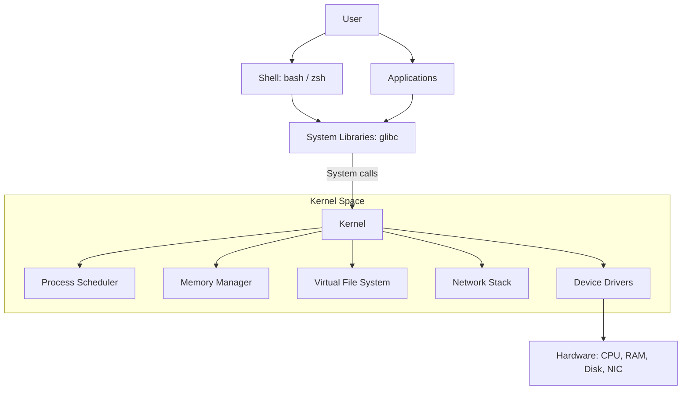
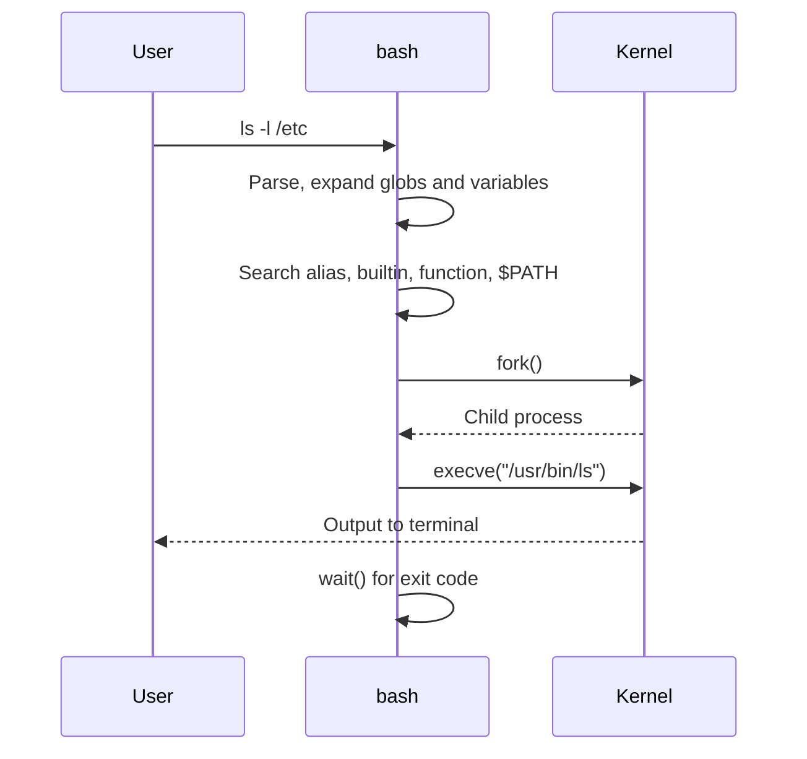
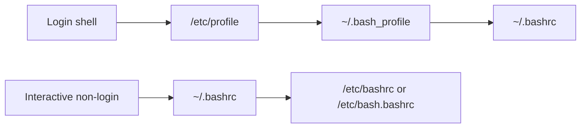

# 01 — Linux Fundamentals

## 1. What Is Linux

Linux is a **kernel**. The kernel controls the hardware. A **distribution** (distro) adds tools, a package manager, and defaults on top of the kernel.

- GNU tools give the user commands (`ls`, `cp`, `bash`).
- The kernel gives process, memory, device, and filesystem management.
- "Linux" in normal speech means kernel + GNU tools + distro.

## 2. Architecture



| Layer | Runs in | Example |
|-------|---------|---------|
| User space | Ring 3, restricted | bash, nginx, python |
| System call interface | Boundary | `open()`, `read()`, `fork()` |
| Kernel space | Ring 0, full access | scheduler, drivers |

**Rule:** User programs cannot touch hardware directly. They ask the kernel through **system calls**.

## 3. Distribution Families

| Family | Distros | Package format | Tool |
|--------|---------|----------------|------|
| Debian | Debian, Ubuntu, Mint | `.deb` | `apt`, `dpkg` |
| Red Hat | RHEL, Rocky, Alma, Fedora, Amazon Linux | `.rpm` | `dnf`, `yum`, `rpm` |
| SUSE | SLES, openSUSE | `.rpm` | `zypper` |
| Arch | Arch, Manjaro | `.pkg.tar.zst` | `pacman` |
| Alpine | Alpine (containers) | `.apk` | `apk` |

Check your distro:

```bash
cat /etc/os-release
uname -r          # kernel release
uname -a          # all kernel info
hostnamectl       # host, OS, kernel, arch
```

## 4. The Shell

The shell reads a command, finds it, runs it, and shows the output.



Command lookup order:
1. Alias
2. Keyword (`if`, `for`)
3. Function
4. Builtin (`cd`, `echo`)
5. External file in `$PATH`

```bash
type ls           # shows how bash resolves "ls"
type -a echo      # all matches
which python3     # path lookup only
echo $PATH
echo $SHELL       # your login shell
echo $0           # current shell
```

### Command Anatomy

```
command  -options  arguments
ls       -la       /var/log
```

- Short options: `-l -a` or `-la`.
- Long options: `--all`.
- `--` ends options: `rm -- -file-with-dash`.

## 5. Getting Help

| Tool | Use |
|------|-----|
| `man ls` | Full manual |
| `man 5 passwd` | Section 5 (file formats) |
| `man -k keyword` / `apropos` | Search manuals |
| `ls --help` | Short usage |
| `help cd` | Bash builtins |
| `info coreutils` | GNU info pages |
| `tldr tar` | Example-based (install `tldr`) |
| `/usr/share/doc/` | Package docs |

Man sections:

| # | Content |
|---|---------|
| 1 | User commands |
| 2 | System calls |
| 3 | Library calls |
| 5 | File formats (`/etc/passwd`) |
| 7 | Overviews (`man 7 signal`) |
| 8 | Admin commands (`mount`, `useradd`) |

In `man`: `/word` to search, `n` for next, `q` to quit.

## 6. Everything Is a File

Linux shows most resources as files.

| Resource | File path |
|----------|-----------|
| Disk | `/dev/sda`, `/dev/nvme0n1` |
| Terminal | `/dev/tty1`, `/dev/pts/0` |
| Process info | `/proc/<PID>/` |
| Kernel settings | `/proc/sys/`, `/sys/` |
| Discard output | `/dev/null` |
| Random bytes | `/dev/urandom` |

File types (first char of `ls -l`):

| Char | Type |
|------|------|
| `-` | Regular file |
| `d` | Directory |
| `l` | Symbolic link |
| `c` | Character device |
| `b` | Block device |
| `s` | Socket |
| `p` | Named pipe (FIFO) |

## 7. Essential Shell Skills

```bash
# History
history | tail
!!            # run last command
sudo !!       # rerun last command with sudo
!ssh          # run last command starting with "ssh"
Ctrl+R        # reverse search history

# Editing
Ctrl+A / Ctrl+E   # start / end of line
Ctrl+U / Ctrl+K   # cut to start / end
Ctrl+W            # cut previous word
Ctrl+L            # clear screen
Ctrl+C            # stop the foreground process
Ctrl+D            # end of input / logout

# Expansion
echo {1..5}           # brace: 1 2 3 4 5
mkdir -p app/{src,test,docs}
echo ~                # tilde: home dir
echo $(date +%F)      # command substitution
echo $((3*4))         # arithmetic
ls *.log              # glob
```

Quotes:

| Quote | Effect | Example |
|-------|--------|---------|
| `'single'` | No expansion | `echo '$HOME'` → `$HOME` |
| `"double"` | Expands `$var`, `$()` | `echo "$HOME"` → `/home/varun` |
| `\` | Escape one char | `echo \$HOME` |

## 8. Environment and Shell Config

```bash
env                     # all environment variables
export APP_ENV=prod     # set for child processes
unset APP_ENV
```

Startup files (bash):



- Put aliases and functions in `~/.bashrc`.
- Put environment variables for login in `~/.bash_profile` or `~/.profile`.
- Apply changes: `source ~/.bashrc`.

## 9. Common Mistakes

| Mistake | Correct action |
|---------|----------------|
| Run commands as root all the time | Use a normal user and `sudo` |
| Use spaces in `VAR = value` | Use `VAR=value` (no spaces) |
| Forget quotes around variables | Use `"$var"` to keep spaces safe |
| Confuse kernel version and distro version | Use `uname -r` vs `cat /etc/os-release` |

## 10. Cheat Sheet

```bash
cat /etc/os-release; uname -r; hostnamectl
type cmd; which cmd; man -k word
history; !!; Ctrl+R
export VAR=x; env; source ~/.bashrc
```
