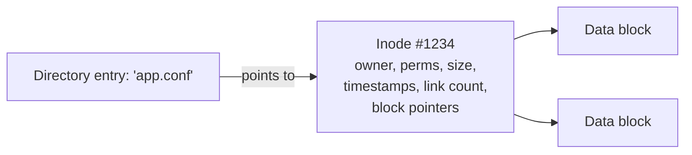
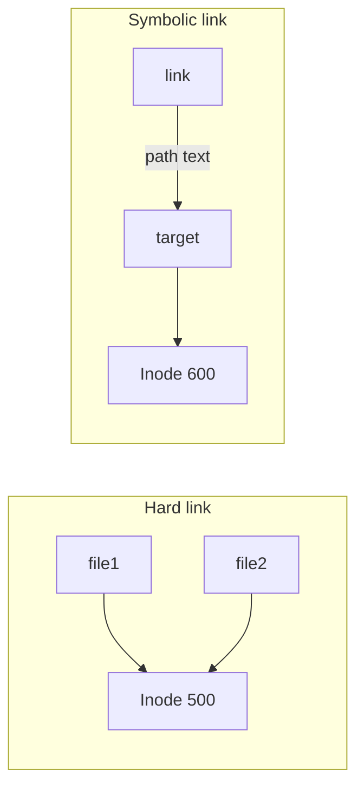

# 02 — Filesystem Hierarchy and Navigation

## 1. One Tree

Linux has one directory tree. It starts at `/` (root). Disks and partitions **mount** into this tree. There are no drive letters.

```mermaid
flowchart TB
    R["/"] --> bin["/bin → /usr/bin"]
    R --> boot["/boot — kernel, initramfs, GRUB"]
    R --> dev["/dev — device files"]
    R --> etc["/etc — system config"]
    R --> home["/home — user dirs"]
    R --> opt["/opt — 3rd-party apps"]
    R --> proc["/proc — process & kernel info (virtual)"]
    R --> root["/root — root user home"]
    R --> run["/run — runtime data (tmpfs)"]
    R --> srv["/srv — served data"]
    R --> sys["/sys — devices & drivers (virtual)"]
    R --> tmp["/tmp — temp files"]
    R --> usr["/usr — programs & libraries"]
    R --> var["/var — variable data: logs, spool, cache"]
    usr --> ub["/usr/bin"]
    usr --> ul["/usr/lib"]
    usr --> ulo["/usr/local — locally built software"]
    var --> vl["/var/log"]
    var --> vlib["/var/lib — app state (docker, mysql)"]
```



## 2. Key Directories (FHS)

| Dir | Content | Admin note |
|-----|---------|-----------|
| `/etc` | Config files | Back this up. Text files. |
| `/var/log` | Logs | Fills disks. Monitor it. |
| `/var/lib` | App state | Docker, databases, packages DB |
| `/tmp` | Temp, cleared on boot (often) | World-writable with sticky bit |
| `/var/tmp` | Temp, kept across reboots | |
| `/usr/local` | Software you install manually | Not touched by package manager |
| `/opt` | Self-contained vendor apps | |
| `/proc`, `/sys` | Virtual, in-memory | Not on disk |
| `/dev` | Device nodes | Managed by udev |
| `/boot` | Kernel `vmlinuz-*`, `initramfs-*` | Keep free space for kernel updates |
| `/run` | PID files, sockets | tmpfs, cleared on boot |

## 3. Paths

- **Absolute path** starts with `/`: `/var/log/syslog`.
- **Relative path** starts from current dir: `logs/app.log`.
- `.` is the current dir. `..` is the parent dir. `~` is home. `-` is the previous dir.

```bash
pwd                 # print working directory
cd /var/log         # absolute
cd ../lib           # relative
cd ~ ; cd           # home
cd -                # previous dir
```

## 4. Listing

```bash
ls -l        # long format
ls -la       # include hidden (dot) files
ls -lh       # human sizes
ls -lt       # sort by time, newest first
ls -ltr      # oldest first (good for logs)
ls -lS       # sort by size
ls -ld /etc  # the dir itself, not content
ls -i        # show inode numbers
tree -L 2    # tree view (install tree)
```

Read `ls -l` output:

```
-rw-r--r--. 1 varun devops 4096 Nov 21 10:00 app.conf
│└──┬────┘│ │ │     │      │    │            └ name
│   │     │ │ │     │      │    └ mtime
│   │     │ │ │     │      └ size (bytes)
│   │     │ │ │     └ group
│   │     │ │ └ owner
│   │     │ └ hard link count
│   │     └ "." = SELinux context, "+" = ACL
│   └ permissions
└ file type
```

## 5. Inodes

An **inode** stores file metadata. It does not store the file name.



- The directory maps **name → inode number**.
- `stat file` shows inode data.
- A disk can run out of **inodes** before it runs out of space. Check with `df -i`.

Timestamps:

| Name | Meaning | Changes when |
|------|---------|-------------|
| atime | Access | File is read (often `relatime`) |
| mtime | Modify | Content changes |
| ctime | Change | Metadata changes (perms, owner) |
| btime | Birth | Created (ext4/xfs, `stat` shows) |

## 6. Hard Links vs Symbolic Links



| | Hard link | Symlink |
|--|-----------|---------|
| Command | `ln target link` | `ln -s target link` |
| Same inode | Yes | No (own inode) |
| Cross filesystem | No | Yes |
| Link to directory | No | Yes |
| Target deleted | Data stays | Link breaks (dangling) |

```bash
ln -s /opt/app-2.1 /opt/app      # versioned deploy pattern
ln -sfn /opt/app-2.2 /opt/app    # switch atomically
readlink -f /opt/app             # resolve full path
find / -xdev -type l ! -exec test -e {} \; -print   # broken links
```

## 7. File Operations

```bash
touch file              # create or update mtime
mkdir -p a/b/c          # create parents
cp -a src dst           # archive: keep perms, times, links
cp -r dir1 dir2         # recursive
mv old new              # rename or move
rm file; rm -r dir      # remove
rm -i *.tmp             # ask before each delete
rmdir emptydir
file unknown.bin        # detect file type by content
stat file               # full metadata
```

## 8. Disk Usage

```bash
df -h          # free space per filesystem
df -i          # inode usage
du -sh /var/*  # size per subdir
du -xh / --max-depth=1 2>/dev/null | sort -h   # largest top-level dirs
ncdu /         # interactive (install ncdu)
```

## 9. Common Mistakes

| Mistake | Correct action |
|---------|----------------|
| Store app data in `/tmp` | Use `/var/lib/<app>` |
| Delete a log that a process holds open | Space is not freed. Truncate: `: > file`, or restart the process |
| Use hard links across mounts | Use symlinks |
| Fill `/boot` with old kernels | Remove old kernels with package tool |

## 10. Cheat Sheet

```bash
pwd; cd -; ls -ltrh; ls -ld dir
stat f; df -h; df -i; du -sh *
ln -s target link; readlink -f link
cp -a; mkdir -p; file f
```
