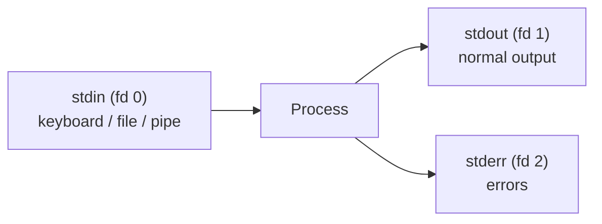
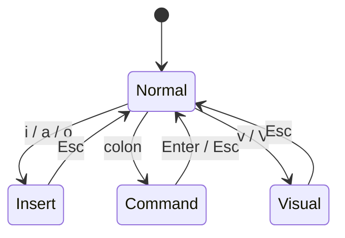

# 03 — Files and Text Processing

## 1. Standard Streams

Every process has three default streams.



## 2. Redirection

| Syntax | Effect |
|--------|--------|
| `cmd > f` | stdout to file (overwrite) |
| `cmd >> f` | stdout to file (append) |
| `cmd 2> f` | stderr to file |
| `cmd > f 2>&1` | stdout and stderr to file |
| `cmd &> f` | Same (bash shortcut) |
| `cmd < f` | File to stdin |
| `cmd 2>/dev/null` | Discard errors |
| `cmd <<EOF ... EOF` | Here-document |
| `cmd <<< "text"` | Here-string |

**Order matters:** `cmd > f 2>&1` sends both to `f`. `cmd 2>&1 > f` sends only stdout to `f`.

```bash
cat > /etc/motd <<'EOF'
Authorized access only.
EOF
```

## 3. Pipes

A pipe `|` connects stdout of one command to stdin of the next.


```bash
# Top 10 client IPs in an nginx log
awk '{print $1}' access.log | sort | uniq -c | sort -rn | head -10

# Save and show at the same time
dmesg | tee dmesg.txt
echo "line" | sudo tee -a /etc/hosts   # write a root file with sudo

# Pipe exit status
set -o pipefail   # pipeline fails if any command fails
```

## 4. Viewing Files

```bash
cat f            # whole file
less f           # page; /search, n, G (end), g (start), q
head -n 20 f     # first 20 lines
tail -n 50 f     # last 50 lines
tail -f f        # follow new lines
tail -F f        # follow across log rotation
wc -l f          # count lines
nl f             # number lines
diff a b; diff -u a b   # compare
```

## 5. find — Search by Metadata

```bash
find /var/log -name "*.log"            # by name
find / -iname "readme*"                # case-insensitive
find /home -type f -size +100M         # files > 100 MB
find /tmp -type f -mtime +7            # modified > 7 days ago
find /etc -newer /etc/hosts            # newer than a file
find / -user varun                     # by owner
find / -perm -4000 2>/dev/null         # SUID files
find . -type d -empty                  # empty dirs
find / -xdev -size +1G                 # stay on one filesystem

# Act on results
find /tmp -name "*.tmp" -mtime +3 -delete
find . -name "*.sh" -exec chmod +x {} \;    # one run per file
find . -name "*.log" -exec gzip {} +        # batch files
find . -name "*.txt" -print0 | xargs -0 grep -l "error"
```

`locate` uses a database. Update it with `updatedb`. It is fast but not live.

## 6. grep — Search by Content

```bash
grep "error" app.log
grep -i "error" app.log           # ignore case
grep -v "debug" app.log           # invert
grep -n "fail" app.log            # line numbers
grep -c "fail" app.log            # count
grep -r "listen" /etc/nginx/      # recursive
grep -rl "password" /etc          # file names only
grep -w "root" /etc/passwd        # whole word
grep -E "error|warn" app.log      # extended regex
grep -A3 -B2 "panic" app.log      # context after/before
grep -o "[0-9]\{1,3\}\(\.[0-9]\{1,3\}\)\{3\}" f   # print only matches
```

### Regex Quick Reference

| Pattern | Meaning |
|---------|---------|
| `.` | Any char |
| `*` | 0 or more of previous |
| `+` (ERE) | 1 or more |
| `?` (ERE) | 0 or 1 |
| `^` / `$` | Line start / end |
| `[abc]` / `[^abc]` | Char set / negated |
| `[0-9]`, `[[:digit:]]` | Digits |
| `\b` | Word boundary |
| `{n,m}` (ERE) | Count range |
| `( )` (ERE) | Group |

`grep -E` = extended regex. `grep -P` = Perl regex (`\d`, lookahead).

## 7. sed — Stream Editor

```bash
sed 's/foo/bar/' f            # first match per line
sed 's/foo/bar/g' f           # all matches
sed -i 's/foo/bar/g' f        # edit in place
sed -i.bak 's/foo/bar/g' f    # in place with backup
sed -n '10,20p' f             # print lines 10–20
sed '/^#/d' f                 # delete comments
sed '/^$/d' f                 # delete blank lines
sed '3i\new line' f           # insert before line 3
sed 's|/usr/local|/opt|g' f   # other delimiter
sed -E 's/(\w+)@(\w+)/\2:\1/' f   # capture groups

# Real use: change SSH port
sudo sed -i 's/^#\?Port .*/Port 2222/' /etc/ssh/sshd_config
```

## 8. awk — Column Processing

awk splits each line into fields: `$1`, `$2`, ... `$NF` (last). `$0` is the full line.

```bash
awk '{print $1, $3}' f
awk -F: '{print $1, $7}' /etc/passwd       # custom separator
awk -F: '$3 >= 1000 {print $1}' /etc/passwd   # filter
awk '/error/ {c++} END {print c}' app.log   # count
awk '{sum += $5} END {print sum/NR}' f      # average column 5
df -h | awk 'NR>1 && $5+0 > 80 {print $6, $5}'   # mounts over 80%
ps aux | awk '{mem[$1]+=$6} END {for (u in mem) print u, mem[u]/1024 " MB"}'
```

Built-in vars: `NR` (line number), `NF` (field count), `FS` (input separator), `OFS` (output separator).

## 9. Other Text Tools

| Tool | Example | Use |
|------|---------|-----|
| `cut` | `cut -d: -f1 /etc/passwd` | Extract fields |
| `sort` | `sort -t: -k3 -n /etc/passwd` | Sort by field 3, numeric |
| `uniq` | `sort f \| uniq -c` | Count duplicates (needs sorted input) |
| `tr` | `tr 'a-z' 'A-Z'`, `tr -d '\r'` | Translate / delete chars |
| `paste` | `paste a b` | Merge lines side by side |
| `column` | `column -t` | Align columns |
| `xargs` | `cat hosts \| xargs -n1 ping -c1` | Build commands from input |
| `jq` | `jq '.items[].name'` | Parse JSON |
| `comm` | `comm -12 a b` | Common lines of sorted files |

## 10. vim Essentials



| Key | Action |
|-----|--------|
| `i`, `a`, `o` | Insert before / after / new line |
| `dd`, `yy`, `p` | Delete line, copy line, paste |
| `u`, `Ctrl+r` | Undo, redo |
| `/text`, `n` | Search, next |
| `:%s/old/new/g` | Replace all |
| `gg`, `G`, `:42` | Top, bottom, line 42 |
| `:w`, `:q`, `:wq`, `:q!` | Save, quit, save+quit, quit without save |
| `:set number` | Line numbers |

## 11. Common Mistakes

| Mistake | Correct action |
|---------|----------------|
| `uniq` on unsorted input | `sort \| uniq` |
| `sed -i` without testing | Run without `-i` first, or use `-i.bak` |
| `sudo echo x > /root/f` | Redirection runs as you. Use `echo x \| sudo tee /root/f` |
| `for f in $(ls)` | Use `for f in *` or `find -print0 \| xargs -0` |
| Windows line endings break scripts | `sed -i 's/\r$//' f` or `dos2unix f` |

## 12. Cheat Sheet

```bash
cmd > f 2>&1; cmd | tee f; set -o pipefail
find / -xdev -type f -size +500M -mtime +30
grep -rniE "err|fail" /var/log
sed -i.bak 's/a/b/g' f; sed -n '5,10p' f
awk -F: '$3>=1000{print $1}' /etc/passwd
sort | uniq -c | sort -rn | head
```
