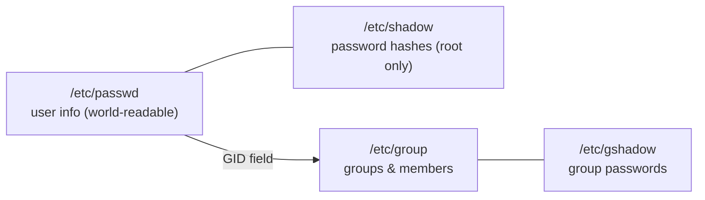
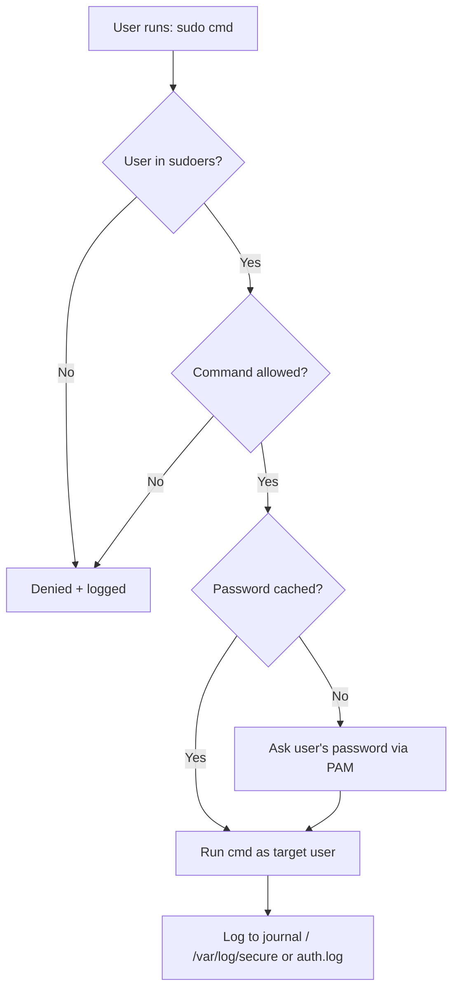
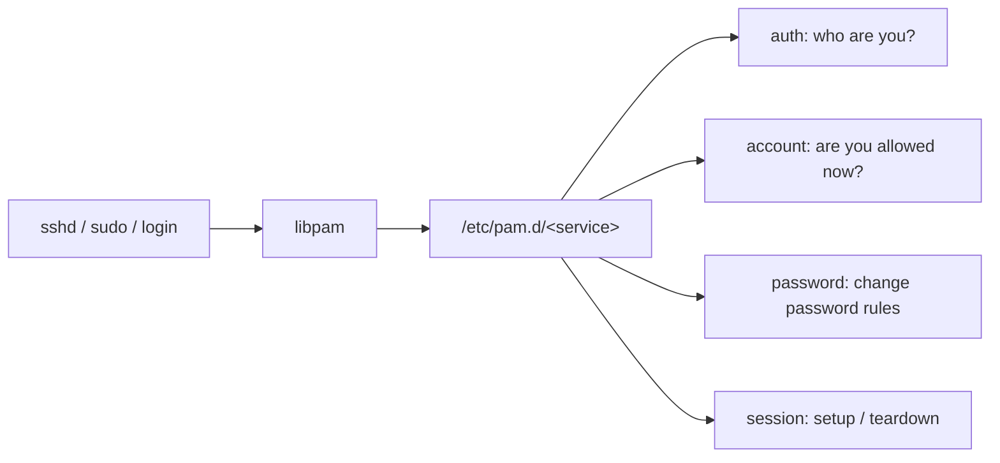

# 04 — Users, Groups, sudo, and PAM

## 1. Identity Model

Each process runs as a **user** (UID) and has a primary **group** (GID) and supplementary groups. The kernel uses numbers, not names.

| Account type | UID range (typical) | Example |
|--------------|---------------------|---------|
| root | 0 | root |
| System / service | 1–999 | nginx, sshd, systemd-* |
| Regular users | 1000+ | varun |

```bash
id                 # your UID, GID, groups
id nginx
whoami
groups varun
who; w; last       # logged-in users and history
```

## 2. Account Files



### /etc/passwd

```
varun:x:1001:1001:Varun G:/home/varun:/bin/bash
  1   2  3    4      5         6          7
```

1. Username 2. `x` = password in shadow 3. UID 4. Primary GID 5. Comment (GECOS) 6. Home 7. Login shell

### /etc/shadow

```
varun:$6$salt$hash...:20050:0:90:7:14::
  1         2          3   4  5  6  7
```

1. User 2. Hash (`$6$` = SHA-512, `$y$` = yescrypt, `!` or `*` = locked) 3. Last change (days since 1970) 4. Min days 5. Max days 6. Warn days 7. Inactive days

### /etc/group

```
devops:x:1050:varun,anita
```

Name : password : GID : member list

**Rule:** Do not edit these files with a plain editor. Use the tools, or `vipw` / `vigr` (they lock the file).

## 3. User Management

```bash
sudo useradd -m -s /bin/bash -c "Anita K" -G devops anita   # -m creates home
sudo passwd anita
sudo usermod -aG docker anita       # ADD to group (-a is critical)
sudo usermod -s /sbin/nologin svc   # disable shell login
sudo usermod -L anita               # lock password
sudo usermod -U anita               # unlock
sudo usermod -e 2026-12-31 contractor   # expiry date
sudo userdel -r anita               # delete with home

sudo chage -l anita                 # password aging info
sudo chage -M 90 -W 7 anita         # max 90 days, warn 7
sudo chage -d 0 anita               # force change at next login

# Service account
sudo useradd -r -s /usr/sbin/nologin -d /var/lib/myapp myapp
```

Debian also has `adduser` (interactive wrapper).

Defaults come from `/etc/login.defs` and `/etc/default/useradd`. New homes copy files from `/etc/skel/`.

## 4. Group Management

```bash
sudo groupadd devops
sudo groupadd -g 2000 dbadmins
sudo gpasswd -a varun devops      # add member
sudo gpasswd -d varun devops      # remove member
sudo groupdel devops
newgrp devops                     # switch primary group in current shell
```

Group changes apply at **next login**. Use `newgrp` or log out and in.

## 5. Switching Users

```bash
su - anita        # full login shell as anita (needs anita's password)
su -              # become root (needs root password)
sudo -i           # root login shell (needs YOUR password + sudo rights)
sudo -u postgres psql
sudo -l           # what can I run with sudo?
```

## 6. sudo



Edit with **visudo** only. It checks syntax before saving.

```bash
sudo visudo                        # edit /etc/sudoers
sudo visudo -f /etc/sudoers.d/devops
```

Rule format:

```
who    where=(as_whom)    what
%devops  ALL=(ALL:ALL)    ALL
deploy   ALL=(root)       NOPASSWD: /usr/bin/systemctl restart myapp
backup   ALL=(root)       /usr/bin/rsync
```

- `%name` = group.
- Admin group: `wheel` (RHEL) or `sudo` (Debian).
- Use drop-in files in `/etc/sudoers.d/` (mode 0440).
- Avoid `NOPASSWD: ALL` for people. Limit commands for automation.
- Do not allow editors, shells, or `less` in rules. They can spawn a root shell.

## 7. PAM — Pluggable Authentication Modules

PAM decides how programs (login, sshd, sudo) authenticate users.



Example lines:

```
auth     required   pam_faillock.so preauth deny=5 unlock_time=900
password requisite  pam_pwquality.so minlen=12 retry=3
session  required   pam_limits.so
```

| Control | Meaning |
|---------|---------|
| required | Must pass; keep checking others |
| requisite | Must pass; stop at once on fail |
| sufficient | Pass = done (if no earlier required failed) |
| optional | Result ignored unless only module |

Useful modules: `pam_faillock` (lockout), `pam_pwquality` (password strength), `pam_limits` (`/etc/security/limits.conf`), `pam_access`.

RHEL uses `authselect` to manage PAM profiles. Do not hand-edit `system-auth` there.

## 8. Resource Limits

```bash
ulimit -a             # current shell limits
ulimit -n             # max open files
```

`/etc/security/limits.conf`:

```
nginx  soft  nofile  65535
nginx  hard  nofile  65535
```

For systemd services, set `LimitNOFILE=65535` in the unit file. `limits.conf` does not apply to systemd services.

## 9. Common Mistakes

| Mistake | Correct action |
|---------|----------------|
| `usermod -G docker user` | Removes other groups. Use `-aG` |
| Edit `/etc/sudoers` with vim | Use `visudo` |
| Expect group change in current session | Log out/in or `newgrp` |
| Shared root password | Personal accounts + sudo + audit |
| Service accounts with shells | Use `/usr/sbin/nologin` |

## 10. Cheat Sheet

```bash
id; getent passwd varun; getent group devops
useradd -m -s /bin/bash -G grp u; passwd u
usermod -aG grp u; usermod -L u; userdel -r u
chage -l u; chage -M 90 u
visudo -f /etc/sudoers.d/x; sudo -l
```
