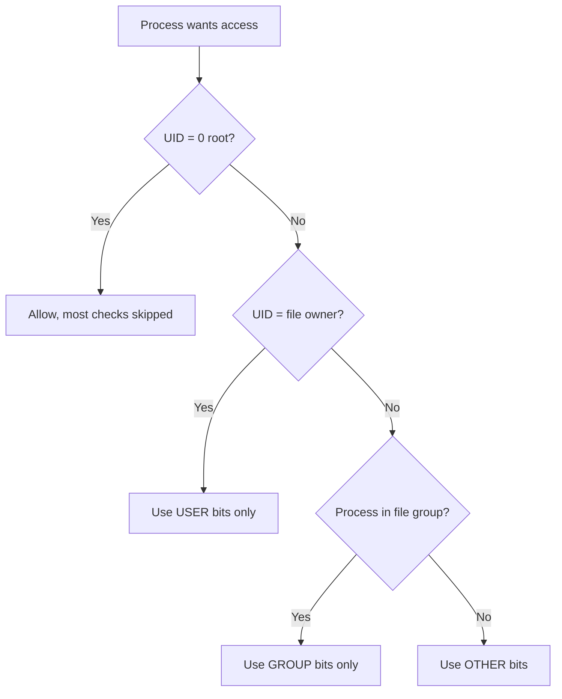
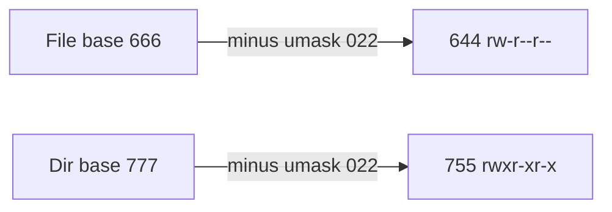

# 05 — Permissions, Ownership, ACLs, Attributes

## 1. The Permission Model

Each file has an **owner**, a **group**, and 9 permission bits in 3 classes.

```
-rwxr-x---  varun devops  deploy.sh
 └┬┘└┬┘└┬┘
  u  g  o
```



**Rule:** Linux checks only **one** class. If you are the owner and owner has no `r`, you cannot read, even if "other" has `r`.

## 2. What rwx Means

| Bit | On a file | On a directory |
|-----|-----------|---------------|
| `r` (4) | Read content | List names (`ls`) |
| `w` (2) | Change content | Create, delete, rename entries |
| `x` (1) | Execute | Enter dir (`cd`), access entries by name |

Key facts:
- To **delete** a file, you need `w` + `x` on the **directory**, not on the file.
- A dir with `x` but no `r`: you can open files if you know names, but cannot list.
- A script needs `r` + `x` to run directly (the shell reads it).

## 3. chmod

### Octal

| Octal | Bits | Common use |
|-------|------|-----------|
| 7 | rwx | |
| 6 | rw- | |
| 5 | r-x | |
| 4 | r-- | |
| 0 | --- | |

```bash
chmod 644 file       # rw-r--r--  normal file
chmod 755 script     # rwxr-xr-x  executable / dir
chmod 600 id_rsa     # rw-------  secrets
chmod 700 ~/.ssh     # rwx------
chmod 750 /srv/app   # owner full, group read/enter
```

### Symbolic

```bash
chmod u+x script
chmod g-w file
chmod o= file           # remove all for other
chmod a+r file          # all classes
chmod u=rw,g=r,o= file
chmod -R g+rX /srv/app  # capital X: x only on dirs (and already-exec files)
```

## 4. chown and chgrp

```bash
sudo chown varun file
sudo chown varun:devops file
sudo chown :devops file        # group only
sudo chgrp devops file
sudo chown -R www-data:www-data /var/www
```

Only root can change owner. Owner can change group to a group they belong to.

## 5. umask

`umask` removes bits from default permissions on new files.



```bash
umask          # 0022 typical; 0002 for user-private-group setups
umask 027      # new files 640, dirs 750
```

Set system-wide in `/etc/login.defs` or `/etc/profile`. For services, use `UMask=` in the systemd unit.

## 6. Special Bits

| Bit | Octal | On file | On directory | `ls` shows |
|-----|-------|---------|--------------|-----------|
| SUID | 4000 | Runs as file **owner** | (ignored) | `rws` in user |
| SGID | 2000 | Runs as file **group** | New files inherit dir **group** | `rws` in group |
| Sticky | 1000 | (ignored) | Only owner can delete their files | `t` in other |

```bash
ls -l /usr/bin/passwd      # -rwsr-xr-x  SUID root
ls -ld /tmp                # drwxrwxrwt  sticky
chmod 2775 /srv/shared     # SGID dir for team
chmod 1777 /scratch        # sticky
chmod u+s binary           # SUID
find / -xdev -perm -4000 -type f 2>/dev/null   # audit SUID files
```

Capital `S` or `T` means the special bit is set but `x` is not.

### Team Shared Directory Pattern

```bash
sudo groupadd devteam
sudo mkdir /srv/devteam
sudo chown root:devteam /srv/devteam
sudo chmod 2770 /srv/devteam      # SGID: files get group devteam
# Optional: add sticky so users cannot delete others' files -> 3770
```

## 7. ACLs — Access Control Lists

Use ACLs when owner/group/other is not enough.

```bash
getfacl file
setfacl -m u:anita:rw file          # give one user rw
setfacl -m g:auditors:r file        # give one group r
setfacl -x u:anita file             # remove entry
setfacl -b file                     # remove all ACLs
setfacl -R -m g:devops:rwX /srv/app # recursive
setfacl -d -m g:devops:rwX /srv/app # DEFAULT ACL: new files inherit
```

- `+` at end of `ls -l` perms means an ACL exists.
- The **mask** limits max rights for named users and groups. `chmod g=...` changes the mask.
- `cp` and `mv` may drop ACLs. Use `cp -a`.

## 8. File Attributes

```bash
lsattr file
sudo chattr +i file     # immutable: even root cannot change/delete
sudo chattr -i file
sudo chattr +a log      # append only
```

A file "cannot be deleted even as root"? Check `lsattr`.

## 9. Capabilities

Capabilities split root power into small parts. Use them instead of SUID.

```bash
getcap /usr/bin/ping
sudo setcap cap_net_bind_service=+ep /usr/local/bin/myapp   # bind port < 1024 as non-root
getcap -r / 2>/dev/null
```

Common: `CAP_NET_BIND_SERVICE`, `CAP_NET_ADMIN`, `CAP_SYS_ADMIN` (almost root), `CAP_CHOWN`.

## 10. Common Mistakes

| Mistake | Correct action |
|---------|----------------|
| `chmod -R 777` to "fix" access | Find the right owner/group; use 750/640 |
| `chmod -R 755` on files | Use `find -type d -exec chmod 755` and `-type f -exec chmod 644`, or `X` |
| SSH key with 644 | `chmod 600 ~/.ssh/id_*`, `700 ~/.ssh` |
| Forget `x` on parent dirs | Every dir in the path needs `x` |
| SUID on scripts | Kernel ignores it; it is also unsafe |

## 11. Cheat Sheet

```bash
chmod 640 f; chmod -R u=rwX,g=rX,o= dir
chown -R u:g dir; umask 027
chmod 2770 shared; chmod 1777 scratch
setfacl -m u:x:rw f; setfacl -d -m g:x:rwX dir; getfacl f
chattr +i f; lsattr f; setcap cap_net_bind_service=+ep bin
namei -l /path/to/file     # perms of every dir in a path
```
