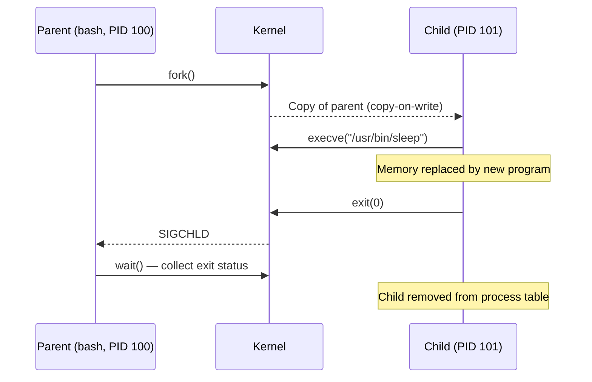
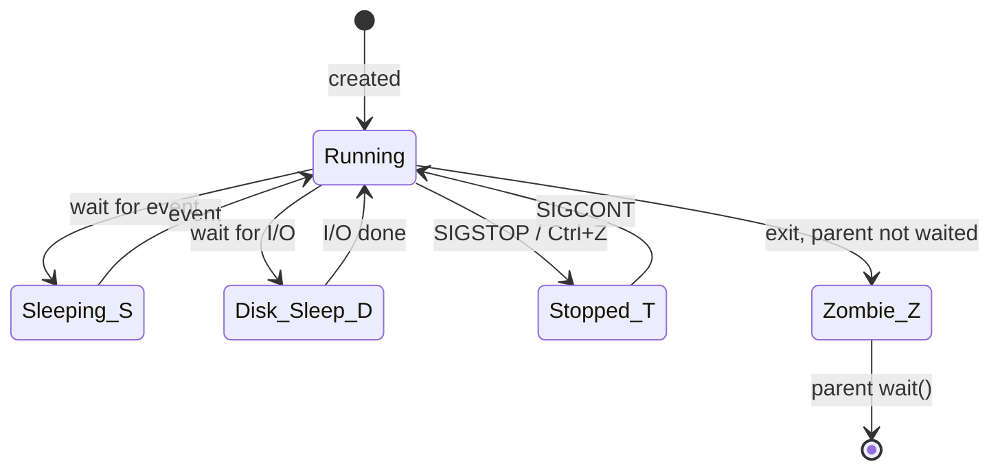
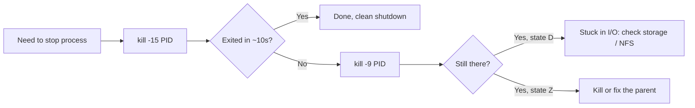

# 06 — Processes, Signals, and Job Control

## 1. What Is a Process

A process is a running program. It has:
- PID (process ID) and PPID (parent PID)
- UID/GID (owner)
- Memory space, open file descriptors, environment
- State, priority, CPU time

PID 1 is `systemd` (or `init`). It is the parent of orphaned processes.

## 2. Process Creation



- If the parent does not call `wait()`, the child stays a **zombie** (`Z`).
- If the parent dies first, the child is an **orphan**. PID 1 adopts it.

## 3. Process States



| Code | State | Note |
|------|-------|------|
| R | Running / runnable | On CPU or in run queue |
| S | Interruptible sleep | Normal idle wait |
| D | Uninterruptible sleep | Waiting for I/O. Cannot be killed. Adds to load average |
| T | Stopped | Ctrl+Z or debugger |
| Z | Zombie | Finished, waiting for parent |
| I | Idle kernel thread | |

## 4. Viewing Processes

```bash
ps aux                       # BSD style: all processes
ps -ef                       # System V style
ps -ef --forest              # tree
pstree -p                    # tree with PIDs
ps -o pid,ppid,user,stat,%cpu,%mem,cmd -p 1234
ps aux --sort=-%mem | head   # top memory users
ps -eLf                      # threads
pgrep -a nginx               # find PIDs by name
pidof sshd
top                          # live view
htop                         # better live view
```

### top keys

| Key | Action |
|-----|--------|
| `P` / `M` | Sort by CPU / memory |
| `1` | Per-CPU view |
| `k` | Kill a PID |
| `r` | Renice |
| `c` | Full command |
| `H` | Threads |

### top header

```
load average: 2.10, 1.80, 1.50    ← 1, 5, 15 min
%Cpu(s): 12 us, 3 sy, 0 ni, 80 id, 4 wa, 0 hi, 1 si, 0 st
```

| Field | Meaning |
|-------|---------|
| us | User code |
| sy | Kernel code |
| ni | Niced processes |
| id | Idle |
| wa | Waiting for I/O |
| st | Stolen by hypervisor (noisy neighbor in cloud) |

**Load average** = average number of processes in R or D state. Compare it with CPU count (`nproc`).

## 5. Signals

A signal is a message to a process.

| Signal | # | Default | Use |
|--------|---|---------|-----|
| SIGHUP | 1 | Terminate | Reload config (many daemons) |
| SIGINT | 2 | Terminate | Ctrl+C |
| SIGQUIT | 3 | Core dump | Ctrl+\ |
| SIGKILL | 9 | Terminate | Force kill. Cannot be caught |
| SIGTERM | 15 | Terminate | Polite stop (default of `kill`) |
| SIGSTOP | 19 | Stop | Pause. Cannot be caught |
| SIGCONT | 18 | Continue | Resume |
| SIGCHLD | 17 | Ignore | Child changed state |
| SIGUSR1/2 | 10/12 | Terminate | App-defined |

```bash
kill PID              # SIGTERM
kill -9 PID           # SIGKILL — last resort
kill -HUP PID         # reload
pkill -f "python app.py"
killall nginx
kill -l               # list signals
```



**Rule:** Use SIGTERM first. SIGKILL gives no chance to flush data or remove lock files.

Kubernetes uses the same flow: SIGTERM, wait `terminationGracePeriodSeconds`, then SIGKILL.

## 6. Job Control

```bash
sleep 300 &         # run in background
jobs                # list jobs
fg %1               # bring job 1 to foreground
Ctrl+Z              # stop foreground job
bg %1               # continue it in background
kill %1
disown -h %1        # do not send SIGHUP on logout
nohup ./long.sh > out.log 2>&1 &   # survive logout
```

For long sessions, use `tmux` or `screen`. For services, use systemd.

## 7. Priority — nice and renice

Nice value: **-20** (highest priority) to **19** (lowest). Default 0. Only root can lower nice.

```bash
nice -n 10 tar czf backup.tgz /data
renice -n 5 -p 1234
ionice -c3 -p 1234        # idle I/O class
chrt -p 1234              # real-time policy
```

## 8. /proc/PID

```bash
ls /proc/1234/
cat /proc/1234/status       # state, memory, threads
cat /proc/1234/cmdline | tr '\0' ' '
ls -l /proc/1234/fd         # open files
cat /proc/1234/limits
cat /proc/1234/environ | tr '\0' '\n'
readlink /proc/1234/cwd
lsof -p 1234                # open files and sockets
```

## 9. Common Mistakes

| Mistake | Correct action |
|---------|----------------|
| `kill -9` as first step | SIGTERM first |
| Try to kill a zombie | Zombie is dead. Fix/restart the parent |
| High load = high CPU | Load includes D state (I/O). Check `wa` and `vmstat` |
| Use `nohup` for services | Use a systemd unit |

## 10. Cheat Sheet

```bash
ps -eo pid,ppid,stat,%cpu,%mem,cmd --sort=-%cpu | head
pgrep -a name; pkill -f pattern; kill -TERM pid
jobs; bg; fg; nohup cmd &; tmux
nice -n 10 cmd; renice -n 5 -p pid
ls -l /proc/PID/fd; lsof -p PID
```
