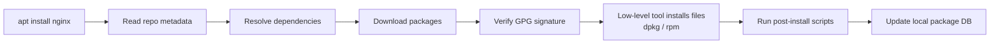
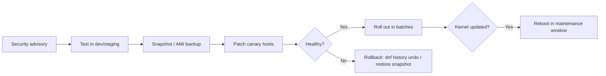

# 07 — Package Management

## 1. What a Package Manager Does

A package is an archive with files, metadata, dependencies, and install scripts.



| Level | Debian | RHEL |
|-------|--------|------|
| High (repos, deps) | `apt` | `dnf` (`yum` on old) |
| Low (single file) | `dpkg` | `rpm` |
| Repo config | `/etc/apt/sources.list`, `/etc/apt/sources.list.d/` | `/etc/yum.repos.d/*.repo` |
| Package DB | `/var/lib/dpkg/` | `/var/lib/rpm/` |

## 2. apt (Debian / Ubuntu)

```bash
sudo apt update                    # refresh repo metadata
sudo apt upgrade                   # upgrade installed packages
sudo apt full-upgrade              # upgrade, allow remove/add deps
sudo apt install nginx=1.24.*      # specific version
sudo apt install ./pkg.deb         # local file with deps
sudo apt remove nginx              # remove, keep config
sudo apt purge nginx               # remove with config
sudo apt autoremove                # remove unused deps
apt search redis
apt show nginx
apt list --installed
apt list --upgradable
apt-cache policy nginx             # versions and repo priority
apt-mark hold kubelet              # pin version
apt-mark unhold kubelet
```

```bash
dpkg -l | grep nginx               # installed?
dpkg -L nginx                      # files from package
dpkg -S /usr/sbin/nginx            # which package owns file
dpkg -i pkg.deb                    # install file (no dep resolve)
dpkg --configure -a                # fix interrupted install
```

### Add a repo (modern way)

```bash
curl -fsSL https://example.com/key.gpg | sudo gpg --dearmor -o /etc/apt/keyrings/example.gpg
echo "deb [signed-by=/etc/apt/keyrings/example.gpg] https://repo.example.com stable main" \
  | sudo tee /etc/apt/sources.list.d/example.list
sudo apt update
```

## 3. dnf (RHEL / Rocky / Alma / Fedora / Amazon Linux 2023)

```bash
sudo dnf check-update
sudo dnf upgrade
sudo dnf install nginx
sudo dnf install nginx-1.24.0      # version
sudo dnf remove nginx
sudo dnf autoremove
dnf search redis
dnf info nginx
dnf list installed
dnf provides /usr/bin/dig          # which package gives a file
dnf repolist
dnf history                        # transactions
sudo dnf history undo 15           # roll back transaction 15
sudo dnf group install "Development Tools"
sudo dnf module list nodejs        # AppStream modules (RHEL 8/9)
sudo dnf install dnf-plugin-versionlock && sudo dnf versionlock add kubelet
sudo dnf config-manager --add-repo https://repo.example.com/x.repo
```

```bash
rpm -qa | grep nginx               # installed?
rpm -qi nginx                      # info
rpm -ql nginx                      # files
rpm -qf /usr/sbin/nginx            # owner package
rpm -qc nginx                      # config files
rpm -V nginx                       # verify files changed since install
rpm -ivh pkg.rpm                   # install file
rpm --import key.asc               # import GPG key
```

### .repo file

```ini
[myrepo]
name=My Repo
baseurl=https://repo.example.com/el9/$basearch
enabled=1
gpgcheck=1
gpgkey=https://repo.example.com/RPM-GPG-KEY
```

EPEL adds extra packages on RHEL: `sudo dnf install epel-release`.

## 4. Command Mapping

| Task | apt | dnf |
|------|-----|-----|
| Refresh | `apt update` | `dnf makecache` |
| Install | `apt install x` | `dnf install x` |
| Remove | `apt remove x` | `dnf remove x` |
| Upgrade all | `apt upgrade` | `dnf upgrade` |
| Search | `apt search x` | `dnf search x` |
| Info | `apt show x` | `dnf info x` |
| Owner of file | `dpkg -S /path` | `rpm -qf /path` |
| Files in pkg | `dpkg -L x` | `rpm -ql x` |
| Pin version | `apt-mark hold x` | `dnf versionlock add x` |

## 5. Other Ways to Install Software

| Method | Example | Note |
|--------|---------|------|
| Snap | `snap install kubectl --classic` | Ubuntu, sandboxed |
| Flatpak | `flatpak install app` | Desktop apps |
| Language pkgs | `pip`, `npm`, `go install` | Use venvs; avoid `sudo pip` |
| Binary download | `curl -LO ...; install -m 755 bin /usr/local/bin/` | Verify checksum |
| Build from source | `./configure && make && sudo make install` | Goes to `/usr/local` |
| Containers | `docker run` | App isolated from host libs |

Verify downloads:

```bash
sha256sum -c kubectl.sha256
```

## 6. Patch Management in Production



```bash
# Security updates only
sudo dnf upgrade --security
sudo unattended-upgrade --dry-run      # Debian/Ubuntu auto security patches

# Reboot needed?
needs-restarting -r                     # RHEL (dnf-utils)
[ -f /var/run/reboot-required ] && echo reboot   # Ubuntu
```

## 7. Common Mistakes

| Mistake | Correct action |
|---------|----------------|
| `apt install` without `apt update` | Run update first, or install fails / gets old version |
| Mix distro repos (e.g., Fedora repo on RHEL) | Use only compatible repos |
| `sudo pip install` into system Python | Use `python3 -m venv` or `pipx` |
| Upgrade kubelet/kernel by accident | Pin with hold / versionlock |
| `gpgcheck=0` | Keep signature checks on |

## 8. Cheat Sheet

```bash
apt update && apt install -y x; apt-cache policy x; dpkg -S /path
dnf install -y x; dnf provides /path; rpm -qf /path; dnf history undo N
apt-mark hold x; dnf versionlock add x
```
