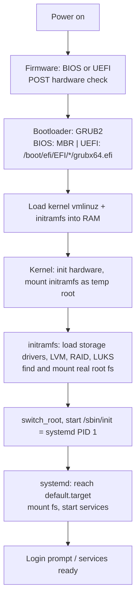
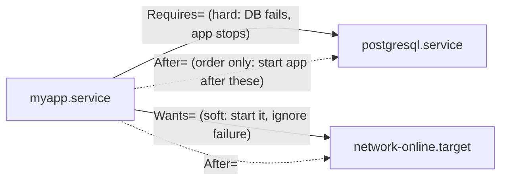

# 08 — Boot Process and systemd

## 1. Boot Sequence



| Stage | Files | Troubleshoot |
|-------|-------|-------------|
| Firmware | NVRAM | `efibootmgr -v` |
| GRUB | `/boot/grub2/grub.cfg`, `/etc/default/grub` | Edit at boot with `e` |
| Kernel | `/boot/vmlinuz-*` | `dmesg`, kernel params |
| initramfs | `/boot/initramfs-*.img` | `dracut -f` (RHEL), `update-initramfs -u` (Debian) |
| systemd | `/etc/systemd/`, `/usr/lib/systemd/` | `journalctl -b`, `systemd-analyze` |

## 2. BIOS vs UEFI

| | BIOS (legacy) | UEFI |
|--|---------------|------|
| Partition table | MBR | GPT |
| Boot code | First 446 bytes of disk | `.efi` file on ESP (FAT32, `/boot/efi`) |
| Max disk | 2 TB | 9.4 ZB |
| Secure Boot | No | Yes |

Check: `[ -d /sys/firmware/efi ] && echo UEFI || echo BIOS`

## 3. GRUB2

```bash
cat /etc/default/grub                     # GRUB_CMDLINE_LINUX, GRUB_TIMEOUT
sudo grub2-mkconfig -o /boot/grub2/grub.cfg   # RHEL BIOS
sudo update-grub                          # Debian/Ubuntu
sudo grubby --update-kernel=ALL --args="console=ttyS0"   # RHEL: edit kernel args
sudo grubby --default-kernel
cat /proc/cmdline                         # args used for this boot
```

Useful kernel parameters at the GRUB `e` screen (add to the `linux` line):

| Param | Effect |
|-------|--------|
| `systemd.unit=rescue.target` | Single-user rescue (needs root pw) |
| `systemd.unit=emergency.target` | Minimal, root fs read-only |
| `rd.break` | Stop in initramfs (RHEL root password reset) |
| `init=/bin/bash` | Bypass systemd (last resort) |
| `nomodeset` | Disable GPU mode setting |

### Reset root password (RHEL family)

```bash
# 1. At GRUB, press e, add "rd.break" to the linux line, Ctrl+X
mount -o remount,rw /sysroot
chroot /sysroot
passwd root
touch /.autorelabel          # needed for SELinux
exit; exit
```

## 4. systemd Concepts

systemd is PID 1. It starts and supervises **units**.

| Unit type | Suffix | Purpose |
|-----------|--------|---------|
| Service | `.service` | Daemon / process |
| Socket | `.socket` | Socket activation |
| Timer | `.timer` | Scheduled job (cron replacement) |
| Mount | `.mount` | Filesystem mount |
| Target | `.target` | Group of units (like runlevels) |
| Path | `.path` | Watch a file path |
| Slice | `.slice` | cgroup resource group |

Unit file locations (priority high → low):

1. `/etc/systemd/system/` — admin overrides (use this)
2. `/run/systemd/system/` — runtime
3. `/usr/lib/systemd/system/` (or `/lib/...`) — package defaults (do not edit)

### Targets vs Runlevels

| Runlevel | Target |
|----------|--------|
| 0 | poweroff.target |
| 1 | rescue.target |
| 3 | multi-user.target |
| 5 | graphical.target |
| 6 | reboot.target |

```bash
systemctl get-default
sudo systemctl set-default multi-user.target
sudo systemctl isolate rescue.target
```

## 5. systemctl

```bash
systemctl status nginx
sudo systemctl start|stop|restart|reload nginx
sudo systemctl enable --now nginx       # start at boot + now
sudo systemctl disable nginx
sudo systemctl mask nginx               # block start completely
systemctl is-active nginx; systemctl is-enabled nginx
systemctl list-units --type=service --state=failed
systemctl list-unit-files --state=enabled
systemctl cat nginx                     # show unit + drop-ins
systemctl show nginx -p MainPID,Restart
sudo systemctl edit nginx               # create drop-in override
sudo systemctl daemon-reload            # after editing unit files
systemctl list-dependencies multi-user.target
```

## 6. Write a Service Unit

`/etc/systemd/system/myapp.service`:

```ini
[Unit]
Description=My API
After=network-online.target
Wants=network-online.target

[Service]
Type=simple
User=myapp
Group=myapp
WorkingDirectory=/opt/myapp
EnvironmentFile=/etc/myapp/env
ExecStart=/opt/myapp/bin/server --port 8080
ExecReload=/bin/kill -HUP $MAINPID
Restart=on-failure
RestartSec=5
LimitNOFILE=65535
# Hardening
NoNewPrivileges=true
ProtectSystem=strict
ProtectHome=true
ReadWritePaths=/var/lib/myapp
PrivateTmp=true

[Install]
WantedBy=multi-user.target
```

```bash
sudo systemctl daemon-reload
sudo systemctl enable --now myapp
journalctl -u myapp -f
```

Service `Type`:

| Type | Use when |
|------|----------|
| simple | Process stays in foreground (default) |
| exec | Like simple, but start fails if exec fails |
| forking | Old daemons that fork to background (need `PIDFile=`) |
| oneshot | Runs and exits (scripts). Use `RemainAfterExit=yes` if needed |
| notify | App tells systemd "ready" via sd_notify |

Dependency keywords:



**Rule:** `Wants=` does not set order. Use `Wants=` + `After=` together.

## 7. Boot Analysis

```bash
systemd-analyze                 # total boot time
systemd-analyze blame           # slowest units
systemd-analyze critical-chain
systemd-analyze verify myapp.service
journalctl -b -p err            # errors this boot
journalctl -b -1                # previous boot (needs persistent journal)
```

## 8. Shutdown

```bash
sudo systemctl reboot
sudo systemctl poweroff
sudo shutdown -r +10 "Kernel patch"
sudo shutdown -c
```

## 9. Common Mistakes

| Mistake | Correct action |
|---------|----------------|
| Edit `/usr/lib/systemd/system/x.service` | Use `systemctl edit x` (drop-in) |
| Forget `daemon-reload` | Run it after any unit change |
| `enable` without `--now` | Service starts only at next boot |
| `After=network.target` for apps needing IP | Use `network-online.target` |
| Bad `/etc/fstab` entry blocks boot | Use `nofail`; test with `mount -a` |

## 10. Cheat Sheet

```bash
systemctl status|start|stop|restart|enable --now|mask x
systemctl --failed; systemctl cat x; systemctl edit x; daemon-reload
systemd-analyze blame; journalctl -b -p err
cat /proc/cmdline; grubby --args=...; dracut -f
```
