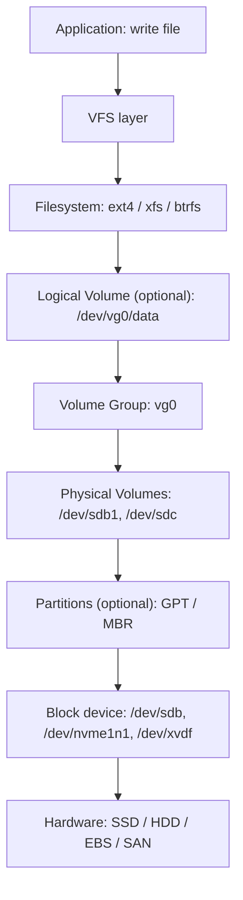
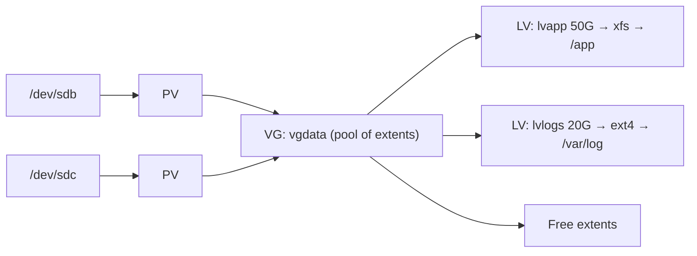
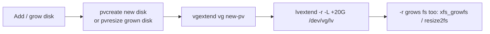

# 09 — Storage: Disks, Partitions, Filesystems, LVM, Swap, RAID

## 1. Storage Stack



## 2. Block Devices

```bash
lsblk                     # tree of disks, partitions, LVs, mounts
lsblk -f                  # with filesystem type, UUID
blkid                     # UUIDs and types
fdisk -l                  # partition tables
cat /proc/partitions
ls -l /dev/disk/by-uuid/
```

| Name | Device |
|------|--------|
| `/dev/sda`, `sdb` | SATA/SCSI/SAS disks |
| `/dev/nvme0n1`, `nvme0n1p1` | NVMe disk, partition 1 |
| `/dev/xvdf` | Xen (old AWS) |
| `/dev/vda` | KVM virtio |
| `/dev/mapper/vg-lv` | Device mapper (LVM, LUKS) |
| `/dev/md0` | Software RAID |

**Rule:** Device names can change between boots. Use **UUID** in `/etc/fstab`.

## 3. Partitioning

| | MBR | GPT |
|--|-----|-----|
| Max disk | 2 TB | Huge |
| Partitions | 4 primary (or extended) | 128 |
| Tools | `fdisk` | `gdisk`, `fdisk`, `parted` |

```bash
sudo fdisk /dev/sdb          # interactive: n (new), t (type), p (print), w (write)
sudo parted /dev/sdb --script mklabel gpt mkpart primary 1MiB 100%
sudo partprobe /dev/sdb      # kernel re-reads table
sudo growpart /dev/nvme0n1 1 # extend partition to fill disk (cloud-utils)
```

## 4. Filesystems

| FS | Strength | Shrink? | Grow tool |
|----|----------|---------|-----------|
| ext4 | Stable, general | Yes (offline) | `resize2fs` |
| xfs | Large files, parallel I/O, RHEL default | **No** | `xfs_growfs` (mount point) |
| btrfs | Snapshots, checksums, subvolumes | Yes | `btrfs filesystem resize` |
| vfat | EFI partition, USB | — | — |
| tmpfs | RAM-based | — | remount size= |

```bash
sudo mkfs.ext4 -L data /dev/sdb1
sudo mkfs.xfs /dev/vg0/lvdata
sudo tune2fs -l /dev/sdb1          # ext4 info
sudo xfs_info /data
sudo fsck -f /dev/sdb1             # check ext4 (UNMOUNTED only)
sudo xfs_repair /dev/sdb1          # repair xfs (UNMOUNTED only)
```

## 5. Mounting

```bash
sudo mkdir /data
sudo mount /dev/sdb1 /data
sudo mount -o ro,noexec /dev/sdc1 /mnt
sudo umount /data
findmnt                       # tree of mounts
findmnt /data
mount | column -t
sudo lsof +D /data            # who blocks umount
sudo fuser -vm /data
```

### /etc/fstab

```
# device                                    mountpoint fstype options          dump fsck
UUID=3f1c...-a9                             /data      xfs    defaults,nofail  0    0
/dev/vg0/lvlogs                             /var/log   ext4   defaults,noatime 0    2
192.168.1.10:/export                        /mnt/nfs   nfs    _netdev,nofail   0    0
tmpfs                                       /scratch   tmpfs  size=2G          0    0
```

| Option | Meaning |
|--------|---------|
| defaults | rw, suid, dev, exec, auto, nouser, async |
| nofail | Boot continues if device is missing |
| _netdev | Wait for network (NFS, iSCSI) |
| noatime | Do not update access time (faster) |
| noexec, nosuid, nodev | Hardening for `/tmp`, `/var/tmp` |
| ro | Read-only |

fsck field: `0` skip, `1` root, `2` others.

**Always test before reboot:**

```bash
sudo findmnt --verify
sudo mount -a
```

## 6. LVM — Logical Volume Manager

LVM puts a flexible layer between disks and filesystems.



### Create

```bash
sudo pvcreate /dev/sdb /dev/sdc
sudo vgcreate vgdata /dev/sdb /dev/sdc
sudo lvcreate -n lvapp -L 50G vgdata
sudo lvcreate -n lvlogs -l 100%FREE vgdata
sudo mkfs.xfs /dev/vgdata/lvapp
```

### Inspect

```bash
pvs; vgs; lvs           # short
pvdisplay; vgdisplay; lvdisplay
```

### Extend (online, common task)



```bash
sudo pvcreate /dev/sdd
sudo vgextend vgdata /dev/sdd
sudo lvextend -r -L +20G /dev/vgdata/lvapp     # -r = resize filesystem
# or use all free space
sudo lvextend -r -l +100%FREE /dev/vgdata/lvapp
```

### Cloud disk grow (AWS EBS root, no LVM)

```bash
# 1. Modify volume size in AWS console / CLI
lsblk
sudo growpart /dev/nvme0n1 1
sudo xfs_growfs /            # xfs
sudo resize2fs /dev/nvme0n1p1   # ext4
```

### Snapshots

```bash
sudo lvcreate -s -n snap_app -L 5G /dev/vgdata/lvapp
sudo lvconvert --merge /dev/vgdata/snap_app    # roll back
```

### Shrink (ext4 only, offline)

```bash
sudo umount /data
sudo e2fsck -f /dev/vg/lv
sudo lvreduce -r -L 30G /dev/vg/lv
```

### Remove a disk from VG

```bash
sudo pvmove /dev/sdb        # move extents off
sudo vgreduce vgdata /dev/sdb
sudo pvremove /dev/sdb
```

## 7. Swap

```bash
swapon --show
free -h
# Swap file
sudo fallocate -l 4G /swapfile      # or dd if=/dev/zero of=/swapfile bs=1M count=4096
sudo chmod 600 /swapfile
sudo mkswap /swapfile
sudo swapon /swapfile
echo '/swapfile none swap defaults 0 0' | sudo tee -a /etc/fstab
cat /proc/sys/vm/swappiness         # 0–200; lower = less swapping
```

Kubernetes nodes traditionally run with swap off (`swapoff -a`), though newer versions support swap.

## 8. Software RAID (mdadm)

| Level | Min disks | Survives | Use |
|-------|-----------|----------|-----|
| 0 | 2 | 0 failures | Speed only |
| 1 | 2 | 1 failure | Mirror |
| 5 | 3 | 1 failure | Capacity + parity |
| 6 | 4 | 2 failures | Big arrays |
| 10 | 4 | 1 per mirror | DB, speed + safety |

```bash
sudo mdadm --create /dev/md0 --level=1 --raid-devices=2 /dev/sdb /dev/sdc
cat /proc/mdstat
sudo mdadm --detail /dev/md0
sudo mdadm --detail --scan | sudo tee -a /etc/mdadm.conf
```

## 9. Network and Other Storage

```bash
# NFS client
sudo mount -t nfs 10.0.0.5:/export /mnt/nfs
showmount -e 10.0.0.5
# Encryption (LUKS)
sudo cryptsetup luksFormat /dev/sdb1
sudo cryptsetup open /dev/sdb1 secure
sudo mkfs.ext4 /dev/mapper/secure
# Loop device (practice)
truncate -s 1G disk.img; sudo losetup -fP disk.img; losetup -a
```

## 10. Common Mistakes

| Mistake | Correct action |
|---------|----------------|
| `/dev/sdb` in fstab | Use `UUID=` |
| Reboot after editing fstab without test | `findmnt --verify; mount -a` |
| `lvextend` without `-r` | FS stays small; run `xfs_growfs`/`resize2fs` |
| Try to shrink xfs | Not possible. Backup, recreate, restore |
| `mkfs` on wrong disk | Check `lsblk` twice. Look at size and mounts |
| fsck on mounted fs | Unmount first |

## 11. Cheat Sheet

```bash
lsblk -f; blkid; findmnt; df -hT
parted /dev/x mklabel gpt mkpart primary 1MiB 100%
pvcreate; vgcreate vg /dev/x; lvcreate -n lv -L 10G vg
lvextend -r -L +5G /dev/vg/lv; growpart /dev/x 1; xfs_growfs /
mkswap; swapon; mount -a
```
