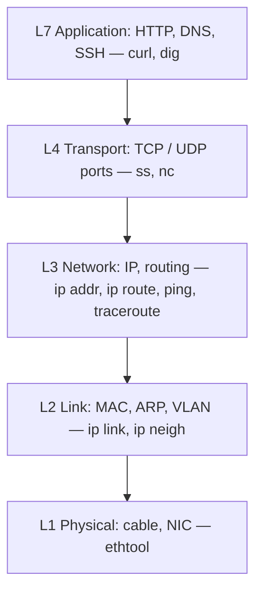
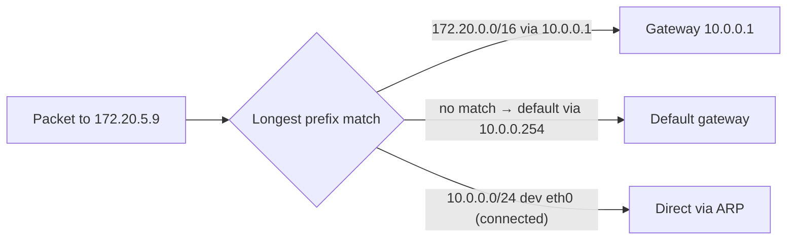
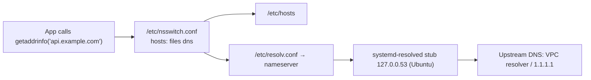
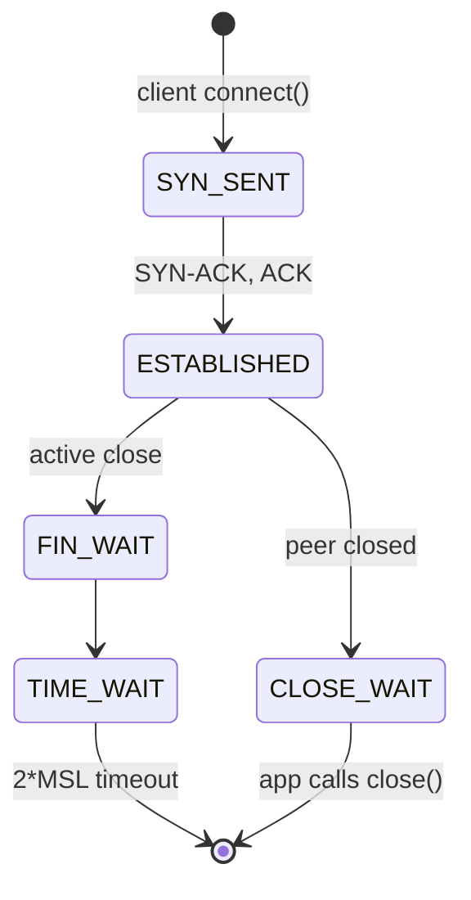
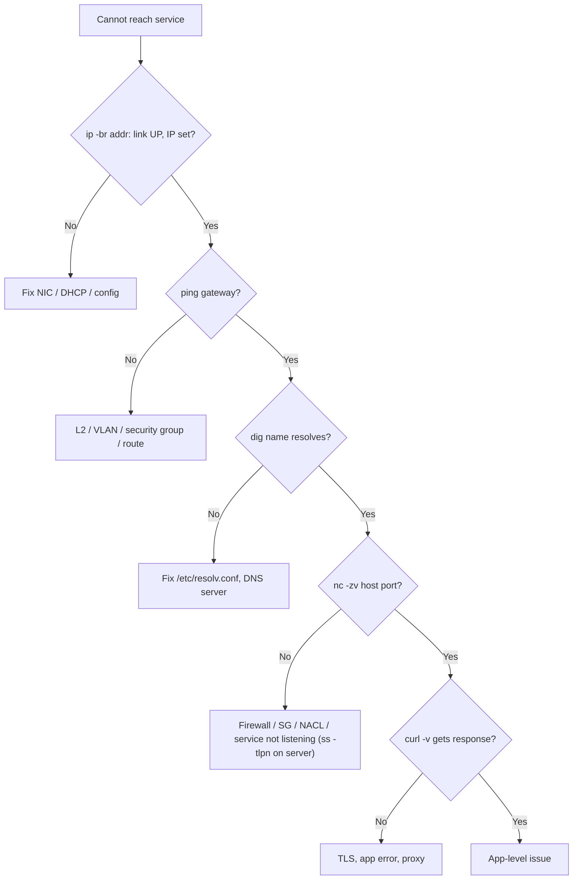

# 10 — Networking

## 1. Layers You Troubleshoot



**Rule:** Troubleshoot bottom-up. Link → IP → route → DNS → port → app.

## 2. Interfaces and Addresses (iproute2)

`ip` replaces old `ifconfig`, `route`, `arp`.

```bash
ip -br addr                 # brief: interface, state, IPs
ip addr show eth0
ip link show
ip link set eth0 up|down
sudo ip addr add 10.0.0.50/24 dev eth0     # temporary
sudo ip addr del 10.0.0.50/24 dev eth0
ip -s link show eth0        # packet/error counters
ethtool eth0                # speed, duplex, link
```

Interface names: `eth0` (old), `ens5`, `enp0s3` (predictable names), `lo` (loopback), `docker0`, `cni0`, `veth*`, `flannel.1`.

## 3. CIDR Quick Reference

| CIDR | Netmask | Hosts |
|------|---------|-------|
| /32 | 255.255.255.255 | 1 |
| /30 | 255.255.255.252 | 2 |
| /28 | 255.255.255.240 | 14 |
| /24 | 255.255.255.0 | 254 |
| /20 | 255.255.240.0 | 4094 |
| /16 | 255.255.0.0 | 65 534 |

Private ranges: `10.0.0.0/8`, `172.16.0.0/12`, `192.168.0.0/16`. Loopback `127.0.0.0/8`. Link-local `169.254.0.0/16` (AWS metadata `169.254.169.254`).

## 4. Routing

```bash
ip route                         # routing table
ip route get 8.8.8.8             # which route/interface/source is used
sudo ip route add 172.20.0.0/16 via 10.0.0.1 dev eth0
sudo ip route add default via 10.0.0.1
sudo ip route del 172.20.0.0/16
```



Enable routing (router/K8s node): `sysctl -w net.ipv4.ip_forward=1`.

## 5. ARP / Neighbors

```bash
ip neigh             # IP → MAC table
sudo ip neigh flush all
```

## 6. Persistent Config

| Distro | Tool | Files |
|--------|------|-------|
| RHEL 8/9, Fedora | NetworkManager (`nmcli`) | `/etc/NetworkManager/system-connections/*.nmconnection` |
| Ubuntu server | netplan → systemd-networkd | `/etc/netplan/*.yaml` |
| Debian (classic) | ifupdown | `/etc/network/interfaces` |

### nmcli

```bash
nmcli device status
nmcli connection show
sudo nmcli con mod "System eth0" ipv4.method manual \
  ipv4.addresses 10.0.0.50/24 ipv4.gateway 10.0.0.1 ipv4.dns "10.0.0.2 1.1.1.1"
sudo nmcli con up "System eth0"
sudo nmcli con add type ethernet ifname eth1 con-name lan2 ipv4.method auto
nmtui                  # text UI
```

### netplan

```yaml
# /etc/netplan/50-static.yaml
network:
  version: 2
  ethernets:
    ens5:
      addresses: [10.0.0.50/24]
      routes:
        - to: default
          via: 10.0.0.1
      nameservers:
        addresses: [10.0.0.2, 1.1.1.1]
```

```bash
sudo netplan try       # auto-rollback if you lose access
sudo netplan apply
```

## 7. DNS Resolution



```bash
cat /etc/resolv.conf
resolvectl status          # systemd-resolved
dig api.example.com
dig +short A api.example.com
dig @8.8.8.8 example.com MX
dig -x 8.8.8.8             # reverse
dig +trace example.com     # full delegation path
nslookup example.com
host example.com
getent hosts api.example.com   # uses nsswitch, like apps do
```

Record types: `A`, `AAAA`, `CNAME`, `MX`, `TXT`, `NS`, `SOA`, `PTR`, `SRV`.

**Tip:** `dig` asks DNS directly. `getent hosts` follows `/etc/hosts` + nsswitch like your app. If they disagree, check `/etc/hosts`.

In Kubernetes pods: `/etc/resolv.conf` has `search` domains and `ndots:5`. Short names trigger many lookups.

## 8. Ports and Sockets

```bash
ss -tulpn             # TCP+UDP listening, process, numeric
ss -tan state established
ss -s                 # summary
ss -tnp dst :5432     # connections to Postgres
cat /etc/services | grep -w 443
sudo lsof -i :8080
```

| Address in ss | Meaning |
|---------------|---------|
| `0.0.0.0:80` | All IPv4 interfaces |
| `127.0.0.1:8080` | Local only. Not reachable from outside |
| `[::]:22` | All IPv6 (often IPv4 too) |

### TCP States



- Many `TIME_WAIT`: normal for busy clients.
- Many `CLOSE_WAIT`: **app bug** — app does not close sockets.

## 9. Connectivity Tests

```bash
ping -c 4 10.0.0.1
traceroute -n 8.8.8.8         # or tracepath
mtr -rwc 50 api.example.com   # ping + traceroute report
nc -zv db.internal 5432       # TCP port open?
nc -zvu 10.0.0.2 53           # UDP
curl -v https://api.example.com/health
curl -o /dev/null -s -w "%{http_code} dns:%{time_namelookup} conn:%{time_connect} tls:%{time_appconnect} total:%{time_total}\n" https://example.com
curl --resolve api.example.com:443:10.0.0.9 https://api.example.com   # test a backend
openssl s_client -connect example.com:443 -servername example.com </dev/null | openssl x509 -noout -dates
```

### Troubleshooting Flow



## 10. Packet Capture

```bash
sudo tcpdump -i eth0 -nn port 443
sudo tcpdump -i any -nn host 10.0.0.9 and port 5432
sudo tcpdump -i eth0 -w cap.pcap       # open in Wireshark
sudo tcpdump -nn -A 'tcp port 80'      # ASCII payload
```

## 11. Hostname

```bash
hostnamectl
sudo hostnamectl set-hostname web01.example.com
cat /etc/hosts
```

## 12. Bonding, Bridges, VLANs (overview)

```bash
sudo nmcli con add type bond ifname bond0 bond.options "mode=active-backup"
sudo ip link add link eth0 name eth0.100 type vlan id 100
sudo ip link add br0 type bridge
```

Containers use: **bridge** (`docker0`), **veth pairs**, **network namespaces** (see module 18).

## 13. Common Mistakes

| Mistake | Correct action |
|---------|----------------|
| App listens on `127.0.0.1` | Bind `0.0.0.0` to accept remote traffic |
| Edit `/etc/resolv.conf` managed by NM/resolved | Change via nmcli/netplan/resolved config |
| `ip addr add` and expect it after reboot | Use nmcli / netplan |
| Blame network for `CLOSE_WAIT` pile-up | Fix app socket handling |
| `ping` fails = host down | ICMP may be blocked. Test the TCP port |

## 14. Cheat Sheet

```bash
ip -br a; ip r; ip route get X; ip neigh
ss -tulpn; ss -tan state established | wc -l
dig +short X; getent hosts X; resolvectl status
nc -zv host port; curl -v URL; mtr host
tcpdump -i any -nn port N
nmcli con mod ...; netplan try
```
