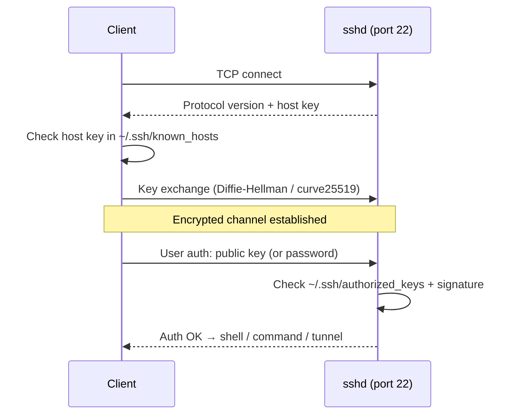
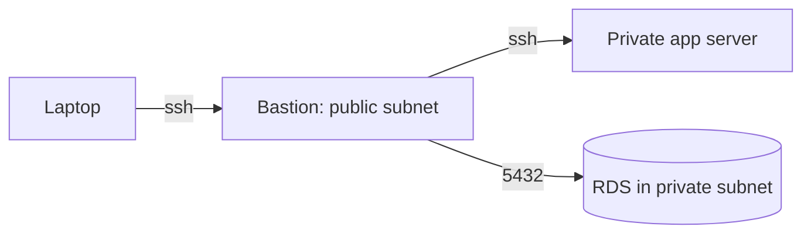

# 11 — SSH and Remote Access

## 1. How SSH Works



- **Host key** proves the server identity (stops man-in-the-middle).
- **User key** proves the user identity.
- Private key never leaves the client.

## 2. Key-Based Login

```bash
ssh-keygen -t ed25519 -C "varun@laptop"      # creates ~/.ssh/id_ed25519 and .pub
ssh-copy-id -i ~/.ssh/id_ed25519.pub user@host
# Manual: append .pub content to server ~/.ssh/authorized_keys
ssh user@host
ssh -i ~/.ssh/aws.pem ec2-user@1.2.3.4
```

Required permissions on the server:

| Path | Mode |
|------|------|
| `~` | not group/other writable |
| `~/.ssh` | 700 |
| `~/.ssh/authorized_keys` | 600 |
| Private key (client) | 600 |

### ssh-agent

```bash
eval "$(ssh-agent -s)"
ssh-add ~/.ssh/id_ed25519
ssh-add -l
ssh -A bastion       # agent forwarding (risky: root on bastion can use your agent)
```

## 3. Client Config (~/.ssh/config)

```
Host bastion
    HostName 3.110.10.20
    User ec2-user
    IdentityFile ~/.ssh/prod.pem

Host app-*
    User ubuntu
    ProxyJump bastion
    IdentityFile ~/.ssh/prod.pem

Host *
    ServerAliveInterval 60
    ServerAliveCountMax 3
    AddKeysToAgent yes
```

Now: `ssh app-01` goes through the bastion automatically.

## 4. Jump Hosts and Tunnels



```bash
ssh -J bastion ubuntu@10.0.2.15                 # ProxyJump

# Local forward: laptop:5433 → (via bastion) → db:5432
ssh -L 5433:db.internal:5432 bastion
psql -h localhost -p 5433

# Remote forward: server:9000 → laptop:3000 (expose local app)
ssh -R 9000:localhost:3000 server

# Dynamic SOCKS proxy
ssh -D 1080 bastion

# Background tunnel only
ssh -fN -L 8443:k8s-api.internal:6443 bastion
```

| Flag | Meaning |
|------|---------|
| `-L` | Local port forward |
| `-R` | Remote port forward |
| `-D` | SOCKS proxy |
| `-N` | No command |
| `-f` | Background |
| `-J` | Jump host |
| `-v`/`-vvv` | Debug |

## 5. File Transfer

```bash
scp file.txt user@host:/tmp/
scp -r dir/ host:/opt/
scp host:/var/log/app.log .
sftp user@host
rsync -avz --progress dir/ host:/backup/dir/      # trailing slash = contents
rsync -avz --delete -e "ssh -J bastion" src/ app-01:/srv/src/
rsync -avzn ...                                   # -n = dry run
```

## 6. Server Config (/etc/ssh/sshd_config)

Hardening baseline:

```
Port 22
PermitRootLogin no
PasswordAuthentication no
KbdInteractiveAuthentication no
PubkeyAuthentication yes
AllowGroups sshusers
MaxAuthTries 3
ClientAliveInterval 300
ClientAliveCountMax 2
X11Forwarding no
AllowTcpForwarding no        # set yes only on bastions
```

Drop-in files: `/etc/ssh/sshd_config.d/*.conf` (loaded first; first value wins).

```bash
sudo sshd -t                     # test config BEFORE restart
sudo systemctl reload sshd
```

**Rule:** Keep your current session open while you change sshd. Test a new login in a second terminal.

If you change the port on RHEL with SELinux:

```bash
sudo semanage port -a -t ssh_port_t -p tcp 2222
sudo firewall-cmd --add-port=2222/tcp --permanent && sudo firewall-cmd --reload
```

## 7. Host Keys and known_hosts

```bash
ssh-keyscan host >> ~/.ssh/known_hosts
ssh-keygen -R host               # remove old key after rebuild
ssh-keygen -lf /etc/ssh/ssh_host_ed25519_key.pub    # fingerprint
```

"REMOTE HOST IDENTIFICATION HAS CHANGED" = host was rebuilt **or** an attack. Verify the fingerprint before you remove the old entry.

## 8. Run Commands Remotely

```bash
ssh host 'uptime; df -h /'
ssh host 'sudo systemctl restart nginx'
for h in web01 web02 web03; do ssh "$h" 'hostname; uptime'; done
pssh -h hosts.txt -i uptime     # parallel-ssh
```

For many hosts, use Ansible.

## 9. Brute-Force Protection

- Keys only, no passwords.
- `fail2ban` bans IPs after failures.
- Restrict port 22 by source IP (security group).
- AWS: use **SSM Session Manager** — no open port 22.

```bash
sudo journalctl -u sshd | grep "Failed password"
sudo lastb | head          # failed logins
```

## 10. Common Mistakes

| Mistake | Correct action |
|---------|----------------|
| `Permissions 0644 for key are too open` | `chmod 600 key` |
| Server ignores key | Fix `~/.ssh` 700, `authorized_keys` 600, home not group-writable; check `journalctl -u sshd` |
| Restart sshd with typo → locked out | `sshd -t` first; keep session open |
| Agent forwarding everywhere | Use `ProxyJump` instead |
| Share one private key across team | One key per person; revoke on leave |

## 11. Cheat Sheet

```bash
ssh-keygen -t ed25519; ssh-copy-id u@h
ssh -J bastion host; ssh -L 5433:db:5432 bastion -fN
rsync -avz --delete src/ h:/dst/
sshd -t && systemctl reload sshd
ssh -vvv host   # debug
```
