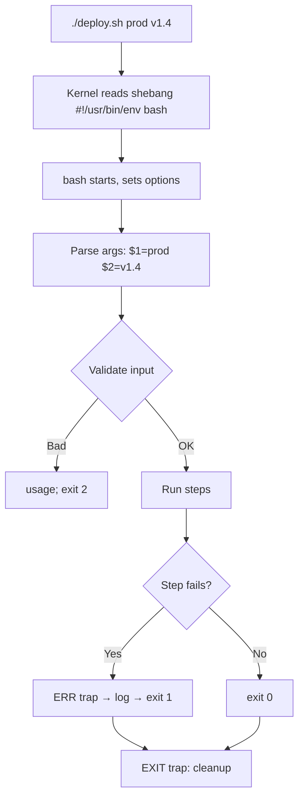

# 12 — Bash Shell Scripting

## 1. Script Skeleton

```bash
#!/usr/bin/env bash
# Purpose: rotate app logs and upload to S3
set -Eeuo pipefail
IFS=$'\n\t'

readonly SCRIPT_NAME="$(basename "$0")"
readonly LOG_DIR="${LOG_DIR:-/var/log/myapp}"

log() { printf '%s [%s] %s\n' "$(date -Is)" "$SCRIPT_NAME" "$*" >&2; }
die() { log "ERROR: $*"; exit 1; }

cleanup() { rm -f "${TMP_FILE:-}"; }
trap cleanup EXIT
trap 'die "failed at line $LINENO"' ERR

main() {
    [[ $EUID -eq 0 ]] || die "run as root"
    TMP_FILE="$(mktemp)"
    log "start"
    # work here
    log "done"
}

main "$@"
```

| Option | Effect |
|--------|--------|
| `set -e` | Exit on any command failure |
| `set -u` | Error on unset variable |
| `set -o pipefail` | Pipeline fails if any part fails |
| `set -E` | ERR trap works in functions |
| `set -x` | Print each command (debug) |

Run: `chmod +x script.sh && ./script.sh` or `bash script.sh`. Lint with **shellcheck**.

## 2. Script Execution Flow



## 3. Variables

```bash
name="varun"              # no spaces around =
echo "$name" "${name}"
echo "${name^^}"          # VARUN
echo "${#name}"           # length 5
readonly PI=3.14
declare -i count=0        # integer
local x=1                 # inside functions only

# Defaults and checks
echo "${ENV:-dev}"        # use dev if unset/empty
echo "${ENV:=dev}"        # assign dev if unset
echo "${ENV:?ENV is required}"   # exit with error if unset

# String operations
file="/var/log/app.log.gz"
echo "${file##*/}"        # app.log.gz   (basename)
echo "${file%/*}"         # /var/log     (dirname)
echo "${file%.gz}"        # /var/log/app.log
echo "${file/log/LOG}"    # replace first
echo "${file:0:4}"        # substring
```

Special variables:

| Var | Meaning |
|-----|---------|
| `$0` | Script name |
| `$1..$9`, `${10}` | Positional args |
| `$#` | Number of args |
| `"$@"` | All args, each quoted (use this) |
| `$?` | Exit code of last command |
| `$$` | PID of the script |
| `$!` | PID of last background job |

**Rule:** Always quote variables: `"$var"`. Unquoted vars split on spaces and expand globs.

## 4. Exit Codes and Tests

`0` = success. `1–255` = failure.

```bash
if grep -q "error" app.log; then echo found; fi
command -v docker >/dev/null || die "docker missing"
mkdir -p /x && cd /x || exit 1
```

`[[ ]]` test operators:

| Test | Meaning |
|------|---------|
| `-f f` / `-d d` / `-e p` | File / dir / exists |
| `-r` `-w` `-x` | Readable / writable / executable |
| `-s f` | File not empty |
| `-z "$s"` / `-n "$s"` | Empty / not empty string |
| `"$a" == "$b"` / `!=` | String equal / not |
| `"$s" =~ ^v[0-9]+` | Regex match |
| `$a -eq $b` (`-ne -lt -le -gt -ge`) | Integer compare |
| `(( a > b ))` | Arithmetic compare |
| `&&` `\|\|` `!` | And / or / not |

## 5. Conditions

```bash
if [[ -f /etc/redhat-release ]]; then
    pkg=dnf
elif [[ -f /etc/debian_version ]]; then
    pkg=apt
else
    die "unsupported OS"
fi

case "$1" in
    start|up)   start_app ;;
    stop)       stop_app ;;
    restart)    stop_app; start_app ;;
    *)          echo "usage: $0 {start|stop|restart}"; exit 2 ;;
esac
```

## 6. Loops

```bash
for host in web01 web02 web03; do
    ssh "$host" uptime
done

for f in /var/log/*.log; do
    [[ -e "$f" ]] || continue
    gzip "$f"
done

for ((i=1; i<=5; i++)); do echo "$i"; done

# Read a file line by line (safe)
while IFS= read -r line; do
    echo "host: $line"
done < hosts.txt

# Retry with backoff
for attempt in {1..5}; do
    curl -fsS http://localhost:8080/health && break
    sleep $((attempt * 2))
done

# Infinite loop
while true; do check; sleep 60; done
```

## 7. Arrays

```bash
servers=(web01 web02 db01)
echo "${servers[0]}"
echo "${servers[@]}"        # all
echo "${#servers[@]}"       # count
servers+=(cache01)
for s in "${servers[@]}"; do echo "$s"; done

declare -A port=([http]=80 [https]=443)
echo "${port[https]}"
for k in "${!port[@]}"; do echo "$k=${port[$k]}"; done

mapfile -t lines < file.txt   # file into array
```

## 8. Functions

```bash
check_port() {
    local host="$1" port="$2"
    if nc -z -w2 "$host" "$port"; then
        echo "$host:$port open"
        return 0
    fi
    return 1
}

check_port db.internal 5432 || log "db down"
result="$(some_function)"     # capture stdout
```

## 9. Input and Arguments

```bash
read -rp "Environment: " env
read -rsp "Password: " pw; echo

# getopts
usage() { echo "usage: $0 -e env [-v]"; exit 2; }
verbose=0
while getopts ":e:vh" opt; do
    case "$opt" in
        e) env="$OPTARG" ;;
        v) verbose=1 ;;
        h|*) usage ;;
    esac
done
shift $((OPTIND - 1))
[[ -n "${env:-}" ]] || usage
```

## 10. Useful Patterns

```bash
# Lock: prevent two runs at once
exec 9>/var/lock/backup.lock
flock -n 9 || die "already running"

# Temp dir with cleanup
tmp="$(mktemp -d)"; trap 'rm -rf "$tmp"' EXIT

# Timeout
timeout 30 ./slow_command || log "timed out"

# Parallel jobs
for h in "${hosts[@]}"; do ssh "$h" uptime & done; wait

# Here-doc config
cat > /etc/myapp.conf <<EOF
env=${ENV}
port=${PORT:-8080}
EOF

# Colors
RED=$'\e[31m'; RESET=$'\e[0m'; echo "${RED}fail${RESET}"

# Date math
date -d "7 days ago" +%F
```

## 11. Debugging

```bash
bash -n script.sh          # syntax check
bash -x script.sh          # trace
set -x; ...; set +x        # trace a block
PS4='+ ${BASH_SOURCE}:${LINENO}: '   # better trace prefix
shellcheck script.sh
```

## 12. Common Mistakes

| Mistake | Correct action |
|---------|----------------|
| `if [ $var == x ]` with empty var | `[[ "$var" == x ]]` |
| `for f in $(ls *.txt)` | `for f in *.txt` |
| `cat file \| while read line` loses variables | `while read -r l; do ...; done < file` |
| `cd dir; rm -rf *` without check | `cd dir \|\| exit 1` |
| Parse `ls` output | Use globs or `find -print0` |
| Secrets in script | Read from env / secrets manager |

## 13. Cheat Sheet

```bash
set -Eeuo pipefail; trap cleanup EXIT
"${VAR:?required}"; "${VAR:-default}"; "${f##*/}"
[[ -f f ]]; (( n > 3 )); case; for; while read -r
getopts; mapfile; flock; mktemp; timeout
shellcheck; bash -x
```
