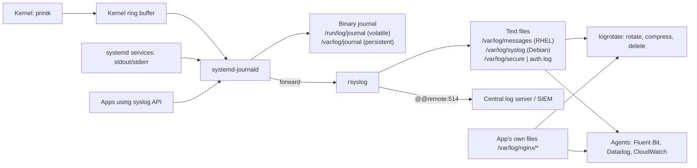
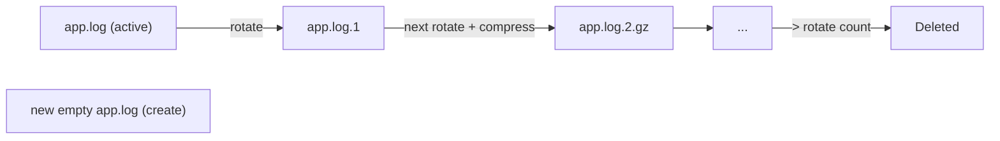

# 13 — Logging: journald, rsyslog, logrotate

## 1. Logging Architecture



## 2. Important Log Files

| File (RHEL) | File (Debian/Ubuntu) | Content |
|-------------|---------------------|---------|
| `/var/log/messages` | `/var/log/syslog` | General system |
| `/var/log/secure` | `/var/log/auth.log` | Auth, sudo, sshd |
| `/var/log/cron` | in syslog | Cron jobs |
| `/var/log/dnf.log` | `/var/log/apt/history.log` | Packages |
| `/var/log/audit/audit.log` | same | auditd, SELinux denials |
| `/var/log/boot.log` | — | Boot messages |
| `/var/log/wtmp`, `btmp` | same | Logins (`last`), failed (`lastb`) |
| `dmesg` | `dmesg` | Kernel ring buffer |

## 3. journalctl

```bash
journalctl                          # all, oldest first
journalctl -r                       # newest first
journalctl -f                       # follow
journalctl -u nginx                 # one unit
journalctl -u nginx -u php-fpm --since "1 hour ago"
journalctl --since "2026-11-21 09:00" --until "2026-11-21 10:00"
journalctl -b                       # this boot
journalctl -b -1                    # previous boot
journalctl --list-boots
journalctl -p err                   # priority err and worse
journalctl -k                       # kernel (like dmesg)
journalctl _PID=1234
journalctl _UID=1001
journalctl -t sshd                  # by syslog identifier
journalctl -o json-pretty -n 5      # structured output
journalctl -o cat -u app            # message only
journalctl -xe                      # recent + explanations
journalctl --disk-usage
sudo journalctl --vacuum-size=500M
sudo journalctl --vacuum-time=14d
```

### Priorities (syslog severity)

| # | Name | Use |
|---|------|-----|
| 0 | emerg | System unusable |
| 1 | alert | Act now |
| 2 | crit | Critical |
| 3 | err | Error |
| 4 | warning | Warning |
| 5 | notice | Normal but significant |
| 6 | info | Info |
| 7 | debug | Debug |

### Persistent journal

By default some distros keep the journal only in RAM (`/run`). Make it persistent:

```bash
sudo mkdir -p /var/log/journal
sudo systemd-tmpfiles --create --prefix /var/log/journal
# or set in /etc/systemd/journald.conf:
#   Storage=persistent
#   SystemMaxUse=1G
sudo systemctl restart systemd-journald
```

## 4. rsyslog

Config: `/etc/rsyslog.conf` and `/etc/rsyslog.d/*.conf`.

Rule format: `facility.priority   action`

```
authpriv.*                  /var/log/secure
*.info;mail.none;authpriv.none   /var/log/messages
local3.*                    /var/log/myapp.log
*.err                       @@logs.internal:514     # @@ = TCP, @ = UDP
```

Facilities: `auth`, `authpriv`, `cron`, `daemon`, `kern`, `mail`, `user`, `local0`–`local7`.

### Central log server

```
# server: /etc/rsyslog.d/server.conf
module(load="imtcp")
input(type="imtcp" port="514")
$template RemoteLogs,"/var/log/remote/%HOSTNAME%/%PROGRAMNAME%.log"
*.* ?RemoteLogs
```

```bash
sudo rsyslogd -N1          # validate config
sudo systemctl restart rsyslog
logger -p local3.info -t myapp "test message"   # write a test log
```

## 5. logrotate

Runs daily (cron or `logrotate.timer`). Config: `/etc/logrotate.conf`, `/etc/logrotate.d/*`.

```
/var/log/myapp/*.log {
    daily
    rotate 14
    compress
    delaycompress
    missingok
    notifempty
    create 0640 myapp myapp
    sharedscripts
    postrotate
        systemctl kill -s HUP myapp.service >/dev/null 2>&1 || true
    endscript
}
```



| Directive | Meaning |
|-----------|---------|
| daily/weekly/monthly | Frequency |
| size 100M | Rotate when size hit |
| rotate N | Keep N old files |
| compress / delaycompress | gzip old files / skip newest one |
| copytruncate | Copy then truncate (for apps that cannot reopen) — may lose lines |
| create mode user group | New file attributes |
| postrotate | Tell app to reopen files |

```bash
sudo logrotate -d /etc/logrotate.d/myapp     # dry run / debug
sudo logrotate -f /etc/logrotate.d/myapp     # force
cat /var/lib/logrotate/status                 # last rotation times
```

## 6. Kernel Messages

```bash
dmesg -T                     # human timestamps
dmesg -T --level=err,warn
dmesg -w                     # follow
dmesg -T | grep -i -E "oom|killed process"   # OOM killer
dmesg -T | grep -i -E "i/o error|ext4|xfs"   # disk errors
```

## 7. Login and Audit Records

```bash
last -n 20            # successful logins
lastb | head          # failed (root)
lastlog               # last login per user
who -b                # last boot time
ausearch -m avc -ts recent       # SELinux denials (auditd)
aureport --auth
```

## 8. Logging in Containers and Cloud

- Containers write to stdout/stderr. The runtime stores them (`/var/log/containers/` on K8s nodes, `/var/lib/docker/containers/*/*-json.log`).
- Ship logs with an agent: Fluent Bit, Vector, Datadog Agent, CloudWatch Agent.
- Use **structured logs** (JSON) for easy search.

## 9. Common Mistakes

| Mistake | Correct action |
|---------|----------------|
| `rm` a big active log | Space not freed. Truncate (`: > file`) or rotate |
| No persistent journal → lost logs after crash | Enable `Storage=persistent` |
| logrotate without `postrotate`/`copytruncate` | App keeps writing to rotated file |
| Logs fill `/var` | Separate `/var/log` volume, rotation, vacuum limits |
| Grep everything for errors | Use `journalctl -p err -u svc --since` |

## 10. Cheat Sheet

```bash
journalctl -u svc -f; journalctl -b -p err; journalctl --since "1h ago"
journalctl --vacuum-size=500M; journalctl --disk-usage
logger -t test "msg"; rsyslogd -N1
logrotate -d /etc/logrotate.d/x
dmesg -T | grep -i oom; last; lastb
```
