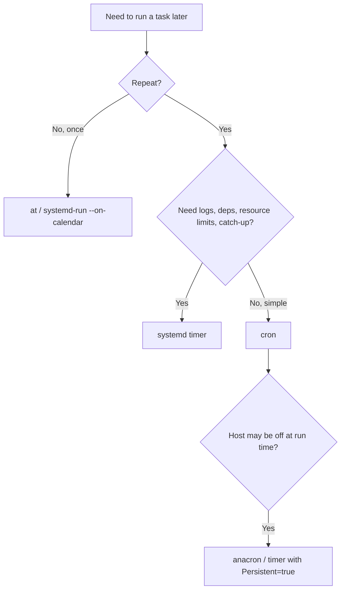
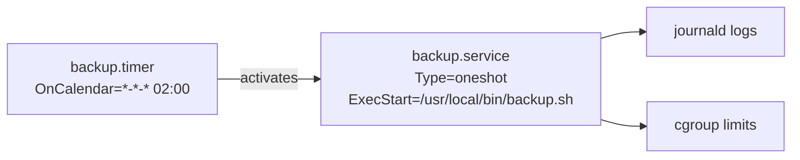

# 14 — Scheduling: cron, at, systemd timers

## 1. Options



## 2. cron

The `crond` (RHEL) / `cron` (Debian) daemon checks schedules every minute.

### Crontab format

```
┌──────── minute (0–59)
│ ┌────── hour (0–23)
│ │ ┌──── day of month (1–31)
│ │ │ ┌── month (1–12)
│ │ │ │ ┌ day of week (0–7, 0 and 7 = Sunday)
│ │ │ │ │
* * * * *  command
```

| Expression | Meaning |
|------------|---------|
| `*/5 * * * *` | Every 5 minutes |
| `0 2 * * *` | 02:00 daily |
| `30 1 * * 0` | 01:30 every Sunday |
| `0 9-18 * * 1-5` | Every hour 9–18, Mon–Fri |
| `0 0 1 * *` | Midnight, 1st of month |
| `15 3 * * 1,3,5` | 03:15 Mon, Wed, Fri |
| `@reboot` | At boot |
| `@daily`, `@hourly`, `@weekly` | Shortcuts |

Check expressions at crontab.guru.

### Where cron jobs live

| Location | Format | Notes |
|----------|--------|-------|
| `crontab -e` (user) | 5 fields + cmd | Stored in `/var/spool/cron/` |
| `/etc/crontab` | 5 fields + **user** + cmd | System |
| `/etc/cron.d/*` | 5 fields + **user** + cmd | Use for packages/apps |
| `/etc/cron.{hourly,daily,weekly,monthly}/` | Executable scripts | Run by anacron/run-parts |

```bash
crontab -e          # edit
crontab -l          # list
crontab -r          # remove all (careful!)
sudo crontab -u app -l
```

### A good cron entry

```
SHELL=/bin/bash
PATH=/usr/local/bin:/usr/bin:/bin
MAILTO=""
# m h dom mon dow command
0 2 * * * /usr/local/bin/backup.sh >> /var/log/backup.log 2>&1
*/10 * * * * flock -n /tmp/sync.lock /opt/sync.sh
```

### cron environment pitfalls

- Minimal `PATH`. Use full paths.
- No `~/.bashrc`.
- `%` means newline in crontab. Escape it: `date +\%F`.
- Output is mailed or lost. Redirect to a log.
- Runs in the server timezone (`timedatectl`).

Access control: `/etc/cron.allow`, `/etc/cron.deny`.

Logs: `/var/log/cron` (RHEL), `grep CRON /var/log/syslog` (Debian), or `journalctl -u crond`.

## 3. anacron

Runs daily/weekly/monthly jobs that were missed while the host was off. Config: `/etc/anacrontab`.

```
# period  delay  job-id      command
1         5      cron.daily  run-parts /etc/cron.daily
```

## 4. at — One-Time Jobs

```bash
sudo systemctl enable --now atd
echo "/usr/local/bin/patch.sh" | at 02:00
at now + 30 minutes <<< "systemctl restart app"
at 10:00 tomorrow
atq            # list
atrm 3         # remove job 3
at -c 3        # show job content
```

## 5. systemd Timers

A timer unit triggers a service unit with the same name.



`/etc/systemd/system/backup.service`:

```ini
[Unit]
Description=Nightly backup

[Service]
Type=oneshot
User=backup
ExecStart=/usr/local/bin/backup.sh
Nice=10
IOSchedulingClass=idle
```

`/etc/systemd/system/backup.timer`:

```ini
[Unit]
Description=Run backup nightly

[Timer]
OnCalendar=*-*-* 02:00:00
RandomizedDelaySec=15min
Persistent=true

[Install]
WantedBy=timers.target
```

```bash
sudo systemctl daemon-reload
sudo systemctl enable --now backup.timer
systemctl list-timers --all
systemctl start backup.service      # run now
journalctl -u backup.service
systemd-analyze calendar "Mon..Fri 09:00"   # validate expression
```

### OnCalendar examples

| Expression | Meaning |
|------------|---------|
| `hourly`, `daily`, `weekly` | Shortcuts |
| `*-*-* 02:00:00` | Daily 02:00 |
| `Mon..Fri 09:00` | Weekdays 09:00 |
| `*:0/15` | Every 15 min |
| `*-*-01 00:00` | 1st of month |

Monotonic timers: `OnBootSec=5min`, `OnUnitActiveSec=1h`.

### One-off transient timer

```bash
sudo systemd-run --on-active=30m /usr/bin/systemctl restart app
sudo systemd-run --on-calendar="2026-11-22 03:00" /usr/local/bin/patch.sh
```

## 6. cron vs systemd timers

| | cron | systemd timer |
|--|------|---------------|
| Setup | 1 line | 2 files |
| Logs | Manual redirect | journald automatic |
| Missed runs | anacron only | `Persistent=true` |
| Overlap protection | `flock` | Built in (service already active) |
| Resource limits | No | cgroups (`MemoryMax=`, `CPUQuota=`) |
| Dependencies | No | `After=`, `Requires=` |
| Random delay | No | `RandomizedDelaySec=` |

Kubernetes equivalent: **CronJob** (uses cron syntax).

## 7. Common Mistakes

| Mistake | Correct action |
|---------|----------------|
| Script works manually, fails in cron | Set `PATH`, use full paths, check env |
| Unescaped `%` in crontab | Use `\%` |
| No output logging | `>> log 2>&1` |
| Overlapping runs | `flock -n` |
| User field in `crontab -e` | Only `/etc/crontab` and `/etc/cron.d` have user field |
| Timer enabled but service also `enable`d | Enable only the timer |

## 8. Cheat Sheet

```bash
crontab -e; crontab -l; /etc/cron.d/
*/5 * * * * cmd >> log 2>&1
at now + 1 hour; atq; atrm N
systemctl list-timers; systemd-analyze calendar "expr"
systemd-run --on-active=10m cmd
```
