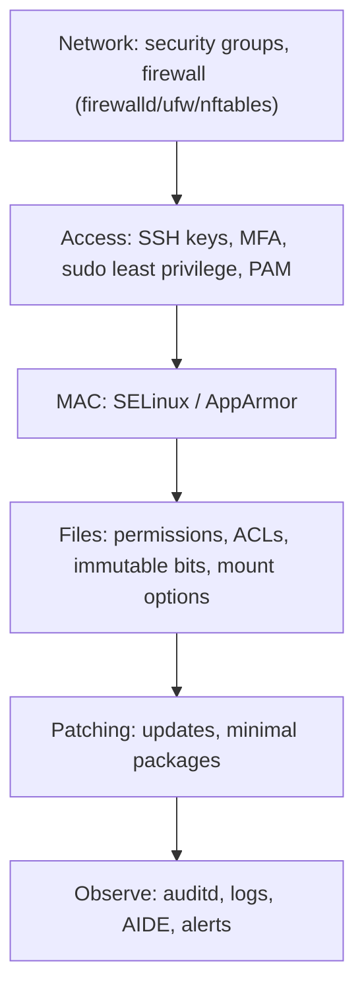
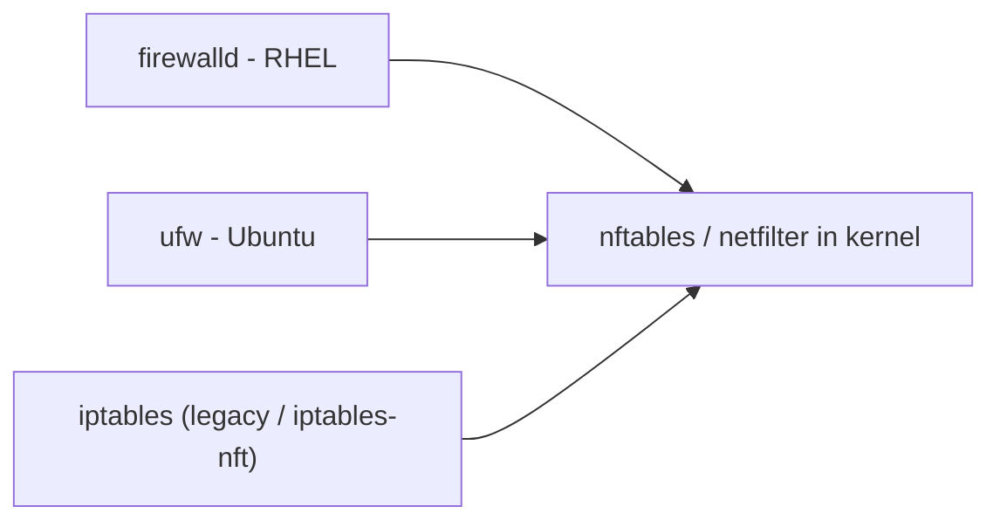
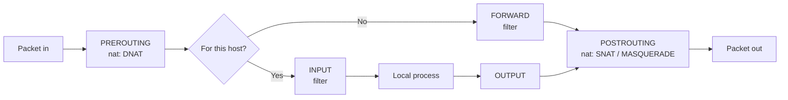
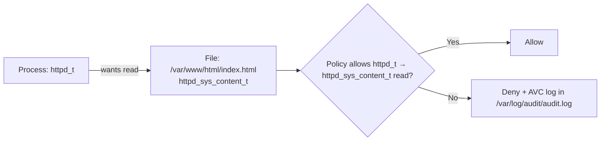

# 15 — Security and Hardening

## 1. Defense in Depth



## 2. Firewalls



### firewalld (RHEL family)

Zones group rules. Each interface is in one zone.

```bash
sudo firewall-cmd --state
sudo firewall-cmd --get-active-zones
sudo firewall-cmd --list-all
sudo firewall-cmd --add-service=https --permanent
sudo firewall-cmd --add-port=8080/tcp --permanent
sudo firewall-cmd --remove-service=cockpit --permanent
sudo firewall-cmd --add-rich-rule='rule family=ipv4 source address=10.0.0.0/16 port port=5432 protocol=tcp accept' --permanent
sudo firewall-cmd --reload
sudo firewall-cmd --get-services
```

**Rule:** Without `--permanent`, a rule is lost on reload. With `--permanent`, it is not active until `--reload`. Use both, or `--runtime-to-permanent`.

### ufw (Ubuntu)

```bash
sudo ufw default deny incoming
sudo ufw default allow outgoing
sudo ufw allow OpenSSH          # allow SSH BEFORE enabling
sudo ufw allow 443/tcp
sudo ufw allow from 10.0.0.0/16 to any port 5432
sudo ufw enable
sudo ufw status numbered
sudo ufw delete 3
```

### iptables / nftables basics



```bash
sudo iptables -L -n -v --line-numbers
sudo iptables -A INPUT -p tcp --dport 22 -s 10.0.0.0/16 -j ACCEPT
sudo iptables -A INPUT -m conntrack --ctstate ESTABLISHED,RELATED -j ACCEPT
sudo iptables -P INPUT DROP
sudo iptables -t nat -L -n          # kube-proxy / docker rules live here
sudo nft list ruleset
```

## 3. SELinux (RHEL family)

SELinux is **Mandatory Access Control**. It checks labels, even for root.



Context format: `user:role:type:level` — the **type** matters most.

```bash
getenforce                    # Enforcing / Permissive / Disabled
sudo setenforce 0             # permissive until reboot (debug only)
sestatus
ls -Z /var/www/html           # file labels
ps -eZ | grep httpd           # process labels
id -Z
```

Permanent mode: `/etc/selinux/config` → `SELINUX=enforcing`.

### Fix common SELinux denials

```bash
# 1. Find denials
sudo ausearch -m AVC -ts recent
sudo journalctl -t setroubleshoot
sudo sealert -a /var/log/audit/audit.log

# 2. Wrong file label (files moved with mv keep old label)
sudo restorecon -Rv /var/www/html

# 3. Custom dir for web content
sudo semanage fcontext -a -t httpd_sys_content_t "/srv/site(/.*)?"
sudo restorecon -Rv /srv/site

# 4. Non-standard port
sudo semanage port -a -t http_port_t -p tcp 8081
sudo semanage port -l | grep http

# 5. Booleans (feature toggles)
getsebool -a | grep httpd
sudo setsebool -P httpd_can_network_connect on     # e.g. reverse proxy

# 6. Last resort: custom module
sudo ausearch -m AVC -ts recent | audit2allow -M mypolicy
sudo semodule -i mypolicy.pp
```

**Rule:** Do not disable SELinux. Fix the label, port, or boolean.

## 4. AppArmor (Ubuntu / SUSE)

Path-based MAC. Profiles in `/etc/apparmor.d/`.

```bash
sudo aa-status
sudo aa-complain /usr/sbin/nginx     # log only
sudo aa-enforce /usr/sbin/nginx
sudo apparmor_parser -r /etc/apparmor.d/usr.sbin.nginx
journalctl -k | grep apparmor
```

## 5. auditd

Records security events: file access, syscalls, logins.

```bash
sudo auditctl -w /etc/passwd -p wa -k identity       # watch writes/attr changes
sudo auditctl -w /etc/sudoers -p wa -k sudoers
sudo auditctl -l
sudo ausearch -k identity
sudo aureport --summary
```

Persistent rules: `/etc/audit/rules.d/*.rules`, then `augenrules --load`.

## 6. Hardening Checklist

| Area | Action |
|------|--------|
| Patching | Automatic security updates; reboot for kernels |
| Packages | Remove unused services: `systemctl list-unit-files --state=enabled` |
| SSH | Keys only, no root login, `AllowGroups` (module 11) |
| sudo | Named users, limited commands, logging |
| Passwords | `pam_pwquality`, `pam_faillock` |
| Firewall | Default deny inbound |
| MAC | SELinux enforcing / AppArmor enforce |
| Mounts | `/tmp`, `/var/tmp`, `/dev/shm` with `nodev,nosuid,noexec` |
| Kernel | sysctl hardening (module 17) |
| Files | Audit SUID/SGID; world-writable files; no `.rhosts` |
| Time | chrony NTP sync (logs and TLS need correct time) |
| Integrity | AIDE file integrity checks |
| Logs | Ship off-host; auditd on |
| Benchmarks | CIS benchmark, OpenSCAP, Lynis |

```bash
sudo lynis audit system
sudo oscap xccdf eval --profile cis --report report.html /usr/share/xml/scap/ssg/content/ssg-rhel9-ds.xml
ss -tulpn                      # what listens?
find / -xdev \( -perm -4000 -o -perm -2000 \) -type f 2>/dev/null
find / -xdev -type f -perm -0002 2>/dev/null
chronyc tracking
```

## 7. Secrets and Crypto Basics

```bash
openssl rand -base64 32                 # random secret
sha256sum file                          # checksum
gpg -c file                             # symmetric encrypt
openssl req -x509 -newkey rsa:4096 -nodes -keyout key.pem -out cert.pem -days 365 -subj "/CN=test"
openssl x509 -in cert.pem -noout -text
```

Store secrets in a manager (AWS Secrets Manager, Vault). Do not keep them in scripts or git.

## 8. Common Mistakes

| Mistake | Correct action |
|---------|----------------|
| `setenforce 0` forever | Fix label/port/boolean |
| `mv` files into `/var/www` → 403 | `restorecon -Rv` (mv keeps old label; cp creates new label) |
| Enable ufw before allowing SSH | `ufw allow OpenSSH` first |
| firewalld rule without `--permanent` | Lost on reload |
| Rules only on host, not SG (or reverse) | Check both layers |

## 9. Cheat Sheet

```bash
firewall-cmd --add-service=x --permanent && firewall-cmd --reload
ufw allow 443/tcp; ufw status numbered
getenforce; ls -Z; restorecon -Rv dir
semanage fcontext -a -t T "/p(/.*)?"; semanage port -a -t T -p tcp N
setsebool -P bool on; ausearch -m AVC -ts recent
auditctl -w file -p wa -k key; ausearch -k key
```
