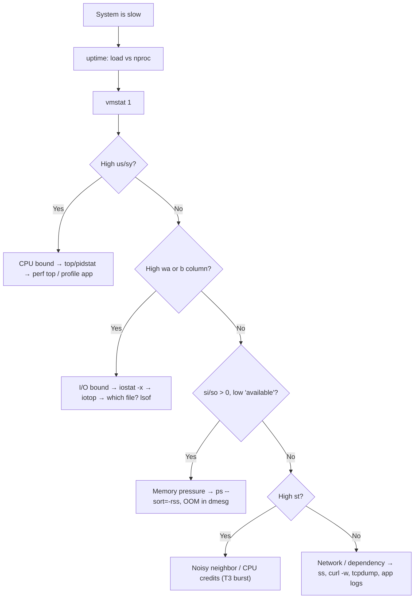
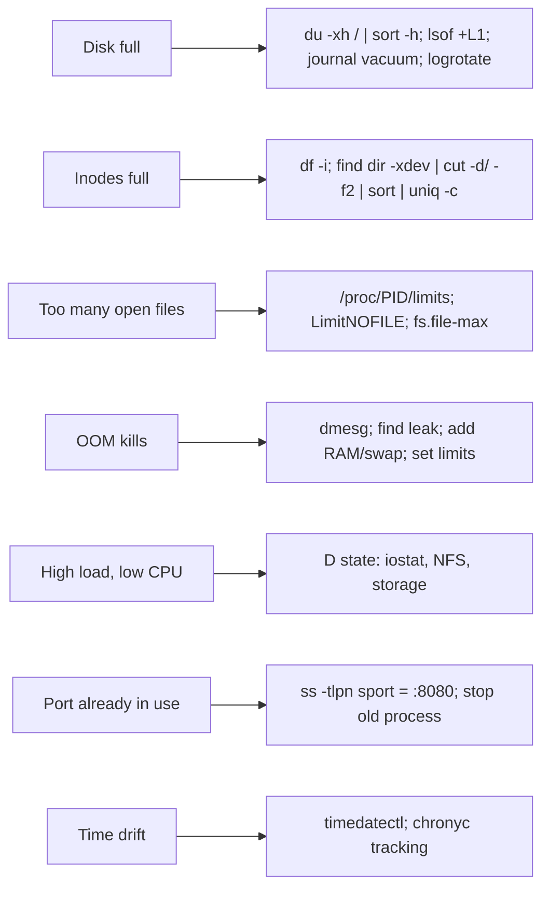

# 16 — Performance and Troubleshooting

## 1. Method: USE

For each resource, check **U**tilization, **S**aturation, **E**rrors.

| Resource | Utilization | Saturation | Errors |
|----------|-------------|-----------|--------|
| CPU | `mpstat -P ALL 1`, top `us+sy` | Load > nproc, `vmstat` `r` column | `dmesg` (MCE) |
| Memory | `free -h` | Swap in/out (`vmstat si/so`), OOM | `dmesg` OOM |
| Disk | `iostat -x` `%util` | `aqu-sz`, `await` | `dmesg` I/O errors, `smartctl` |
| Network | `sar -n DEV 1` | Drops, retransmits (`nstat`, `ss -ti`) | `ip -s link` errors |

## 2. The 60-Second Checklist

```bash
uptime                      # load averages trend
dmesg -T | tail             # OOM, disk errors, kernel issues
vmstat 1 5                  # r, b, si/so, us/sy/wa/st
mpstat -P ALL 1 3           # per-CPU balance
pidstat 1 3                 # per-process CPU
iostat -xz 1 3              # disk latency and util
free -h                     # memory
sar -n DEV 1 3              # network throughput
sar -n TCP,ETCP 1 3         # connections, retransmits
top / htop                  # overview
```

(`mpstat`, `pidstat`, `iostat`, `sar` come from the **sysstat** package.)



## 3. CPU

```bash
nproc; lscpu
top -H -p PID               # threads of a process
pidstat -u -p PID 1
perf top                    # hot functions (linux-tools / perf)
perf record -g -p PID -- sleep 30; perf report
```

vmstat columns:

| Col | Meaning |
|-----|---------|
| r | Runnable (waiting for CPU) |
| b | Blocked (D state, I/O) |
| si / so | Swap in / out per sec |
| bi / bo | Blocks in / out |
| in / cs | Interrupts / context switches |
| us sy id wa st | CPU split |

AWS T-family: when CPU credits are gone, the instance is throttled to baseline. Check `CPUCreditBalance` in CloudWatch.

## 4. Memory

```bash
free -h
cat /proc/meminfo
ps aux --sort=-rss | head
smem -rk                    # proportional memory (install smem)
slabtop                     # kernel slab caches
```

Read `free -h`:

```
       total  used  free  shared  buff/cache  available
Mem:    15Gi   6Gi  500Mi  200Mi       9Gi       8Gi
```

- **free** low is normal. Linux uses spare RAM for **page cache**.
- Watch **available**. That is memory apps can get.
- Clear cache (test only): `sync; echo 3 > /proc/sys/vm/drop_caches`.

### OOM Killer

When memory is exhausted, the kernel kills a process with high `oom_score`.

```bash
dmesg -T | grep -i -E "out of memory|killed process"
cat /proc/PID/oom_score
echo -1000 > /proc/PID/oom_score_adj     # protect (systemd: OOMScoreAdjust=)
```

In containers/K8s: hitting the cgroup `memory.max` gives **OOMKilled** (exit code 137).

## 5. Disk I/O

```bash
iostat -xz 1
iotop -oPa                  # per-process I/O
pidstat -d 1
lsof +D /var/lib/mysql | head
df -h; df -i
smartctl -a /dev/sda        # disk health
fio --name=test --rw=randread --bs=4k --size=1G --runtime=30 --time_based   # benchmark
```

iostat key fields:

| Field | Meaning | Concern |
|-------|---------|---------|
| r/s, w/s | IOPS | Near volume limit (EBS gp3 3000 base) |
| rkB/s, wkB/s | Throughput | Near MB/s limit |
| r_await, w_await | Latency ms | > 10–20 ms on SSD |
| aqu-sz | Queue length | > 1 sustained |
| %util | Busy time | ~100% (less meaningful on NVMe/SSD) |

## 6. Network Performance

```bash
sar -n DEV 1
ip -s link
nstat -az | grep -i retrans
ss -ti dst 10.0.0.9          # per-connection RTT, cwnd, retrans
iperf3 -s   /   iperf3 -c server -t 30     # throughput test
ethtool -S eth0 | grep -i drop
```

## 7. Tracing Tools

```bash
strace -p PID                     # live syscalls
strace -f -e trace=open,openat,connect -o trace.txt ./app
strace -c -p PID                  # syscall summary (Ctrl+C)
ltrace ./app                      # library calls
lsof -p PID                       # open files and sockets
lsof -i :443
```

eBPF tools (bcc / bpftrace):

```bash
execsnoop        # new processes
opensnoop        # file opens
biolatency       # disk latency histogram
tcpconnect       # outbound TCP
tcpretrans       # retransmits
```

## 8. Common Problems and Fixes



## 9. Historical Data

```bash
sar -u -f /var/log/sa/sa21          # CPU on the 21st (RHEL path)
sar -r                              # memory history
sar -d                              # disk history
```

Enable: `systemctl enable --now sysstat`.

For production, use metrics (Prometheus node_exporter, Datadog, CloudWatch agent) and dashboards (Grafana).

## 10. Troubleshooting Mindset

1. Define the problem: what, since when, who is affected?
2. Check what changed (deploys, patches, config, traffic).
3. Gather data before you restart. Restart destroys evidence.
4. Form one hypothesis. Test it. Change one thing at a time.
5. Write down the timeline and the fix (postmortem).

## 11. Common Mistakes

| Mistake | Correct action |
|---------|----------------|
| "free shows 200 MB, we need RAM!" | Check `available`; cache is reclaimable |
| Restart first, investigate later | Capture `ps`, `dmesg`, logs first |
| Trust `%util` on NVMe | Use await and queue size |
| Ignore `st` in cloud | Check instance type, credits, neighbors |

## 12. Cheat Sheet

```bash
uptime; dmesg -T | tail; vmstat 1; mpstat -P ALL 1; pidstat 1
iostat -xz 1; free -h; sar -n DEV 1; ss -s
strace -p PID; lsof -p PID; perf top
ps aux --sort=-%cpu | head; ps aux --sort=-rss | head
```
