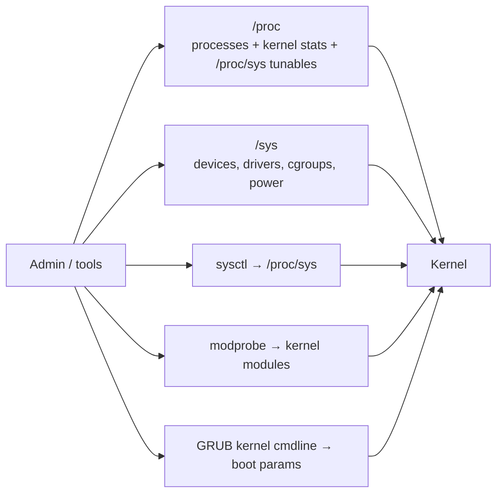
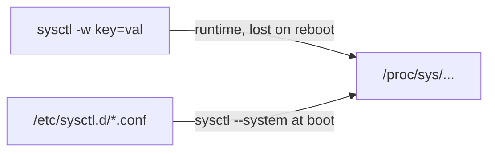

# 17 — Kernel, Modules, /proc, /sys, sysctl

## 1. Kernel Interfaces



## 2. Kernel Version and Info

```bash
uname -r                       # 5.14.0-427.el9.x86_64
uname -m                       # architecture
cat /proc/version
cat /proc/cmdline              # boot parameters
ls /boot                       # installed kernels
rpm -q kernel / dpkg -l 'linux-image*'
```

Version format: `major.minor.patch-distro_build`.

## 3. /proc

| Path | Content |
|------|---------|
| `/proc/cpuinfo` | CPU model, flags, cores |
| `/proc/meminfo` | Memory details |
| `/proc/loadavg` | Load + running/total tasks |
| `/proc/uptime` | Seconds up |
| `/proc/mounts` | Mounted filesystems |
| `/proc/partitions` | Block devices |
| `/proc/interrupts` | IRQs per CPU |
| `/proc/net/dev`, `/proc/net/tcp` | Network stats, sockets |
| `/proc/sys/` | Tunable kernel parameters |
| `/proc/PID/` | Per-process data (module 06) |
| `/proc/pressure/{cpu,memory,io}` | PSI: stall time (great saturation metric) |

```bash
grep -c processor /proc/cpuinfo
grep -E "MemTotal|MemAvailable" /proc/meminfo
cat /proc/pressure/memory
```

## 4. /sys

```bash
ls /sys/class/net/                     # interfaces
cat /sys/class/net/eth0/speed
cat /sys/block/sda/queue/scheduler     # I/O scheduler
cat /sys/fs/cgroup/cgroup.controllers  # cgroup v2
ls /sys/module/                        # loaded modules and params
cat /sys/kernel/mm/transparent_hugepage/enabled
```

## 5. sysctl — Runtime Kernel Tuning

```bash
sysctl -a | grep ip_forward
sysctl net.ipv4.ip_forward
sudo sysctl -w net.ipv4.ip_forward=1        # runtime only
# same as: echo 1 > /proc/sys/net/ipv4/ip_forward
```

Persistent: create `/etc/sysctl.d/99-custom.conf`, then:

```bash
sudo sysctl --system      # load all sysctl.d files
sudo sysctl -p /etc/sysctl.d/99-custom.conf
```



### Common Parameters

| Parameter | Typical value | Why |
|-----------|---------------|-----|
| `net.ipv4.ip_forward` | 1 | Routers, K8s nodes, Docker |
| `net.bridge.bridge-nf-call-iptables` | 1 | K8s: bridged traffic through iptables (needs `br_netfilter`) |
| `vm.swappiness` | 10 | Less swapping on servers/DBs |
| `vm.max_map_count` | 262144 | Elasticsearch / OpenSearch |
| `vm.overcommit_memory` | 0/1/2 | Redis recommends 1 |
| `fs.file-max` | high | System-wide open files |
| `fs.inotify.max_user_watches` | 524288 | IDEs, file watchers, K8s |
| `net.core.somaxconn` | 4096+ | Listen backlog for busy servers |
| `net.ipv4.ip_local_port_range` | `1024 65535` | More outbound ports |
| `net.ipv4.tcp_tw_reuse` | 1 | Reuse TIME_WAIT for outbound |
| `kernel.pid_max` | 4194304 | Many processes/threads |

### Security Parameters

```
net.ipv4.conf.all.rp_filter = 1
net.ipv4.conf.all.accept_redirects = 0
net.ipv4.conf.all.send_redirects = 0
net.ipv4.icmp_echo_ignore_broadcasts = 1
net.ipv4.tcp_syncookies = 1
kernel.randomize_va_space = 2
kernel.kptr_restrict = 2
kernel.dmesg_restrict = 1
fs.protected_symlinks = 1
fs.protected_hardlinks = 1
fs.suid_dumpable = 0
```

### Kubernetes Node Prep

```bash
cat <<EOF | sudo tee /etc/modules-load.d/k8s.conf
overlay
br_netfilter
EOF
sudo modprobe overlay && sudo modprobe br_netfilter

cat <<EOF | sudo tee /etc/sysctl.d/k8s.conf
net.bridge.bridge-nf-call-iptables  = 1
net.bridge.bridge-nf-call-ip6tables = 1
net.ipv4.ip_forward                 = 1
EOF
sudo sysctl --system
```

## 6. Kernel Modules

Modules add drivers and features without a reboot. Files: `/lib/modules/$(uname -r)/`.

```bash
lsmod                          # loaded modules
modinfo br_netfilter           # info, params
sudo modprobe br_netfilter     # load with deps
sudo modprobe -r module        # unload
```

| File | Purpose |
|------|---------|
| `/etc/modules-load.d/*.conf` | Load at boot |
| `/etc/modprobe.d/*.conf` | Options and blacklist |

```
# /etc/modprobe.d/blacklist-usb-storage.conf
blacklist usb-storage
install usb-storage /bin/false
```

## 7. Kernel Updates

```bash
sudo dnf update kernel        # RHEL: new kernel installed beside old
sudo apt install linux-image-generic
sudo grubby --default-kernel
sudo grubby --set-default /boot/vmlinuz-<version>
# Live patching (no reboot): kpatch (RHEL), Canonical Livepatch (Ubuntu)
```

Keep at least one older kernel as fallback. Choose it in the GRUB menu if the new one fails.

## 8. Kernel Panic and Crash Dumps

- **Panic**: fatal kernel error. Host stops or reboots.
- **kdump** saves memory to `/var/crash/` for analysis.

```bash
sudo systemctl enable --now kdump
sysctl kernel.panic             # seconds before auto-reboot after panic
echo c > /proc/sysrq-trigger    # FORCE crash (lab only!)
```

## 9. Hugepages and Transparent Hugepages

- Hugepages (2 MB/1 GB) reduce TLB misses for big memory apps.
- Many DBs (MongoDB, Redis, Oracle) recommend **disabling THP**:

```bash
echo never | sudo tee /sys/kernel/mm/transparent_hugepage/enabled
```

## 10. Common Mistakes

| Mistake | Correct action |
|---------|----------------|
| `sysctl -w` and expect it after reboot | Put it in `/etc/sysctl.d/` |
| Edit `/etc/sysctl.conf` and drop-ins conflict | Use one numbered drop-in; later files win |
| `bridge-nf-call-iptables` missing key | Load `br_netfilter` first |
| Copy tuning from blogs blindly | Change one value, measure |

## 11. Cheat Sheet

```bash
uname -r; cat /proc/cmdline; cat /proc/pressure/io
sysctl key; sysctl -w key=v; sysctl --system
lsmod; modinfo m; modprobe m; /etc/modules-load.d/
grubby --default-kernel; systemctl status kdump
```
