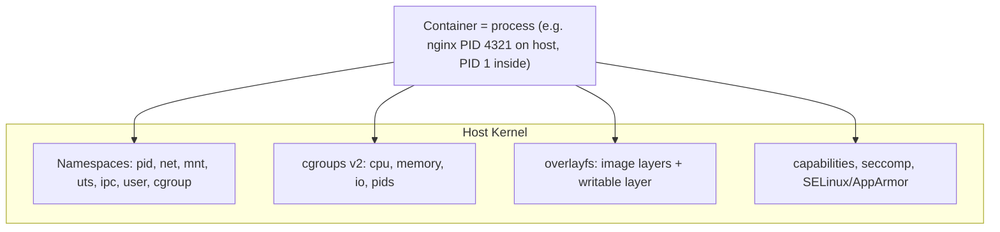
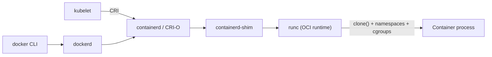
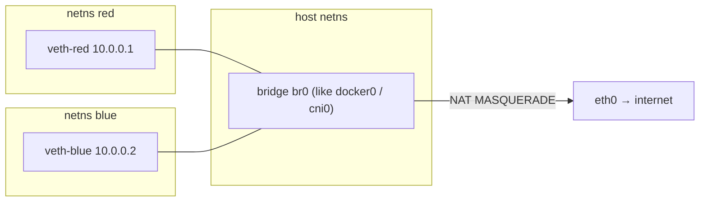
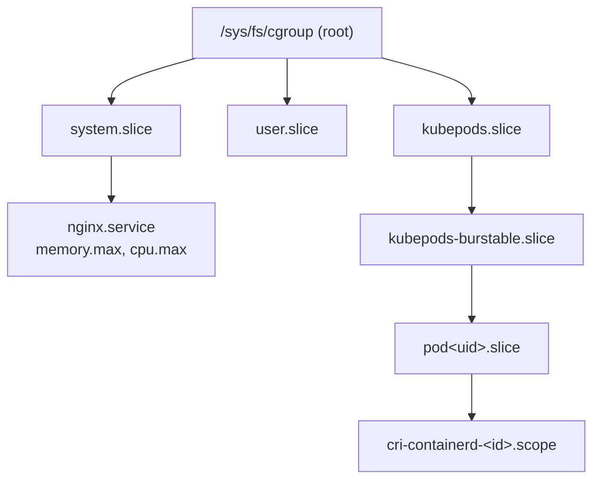
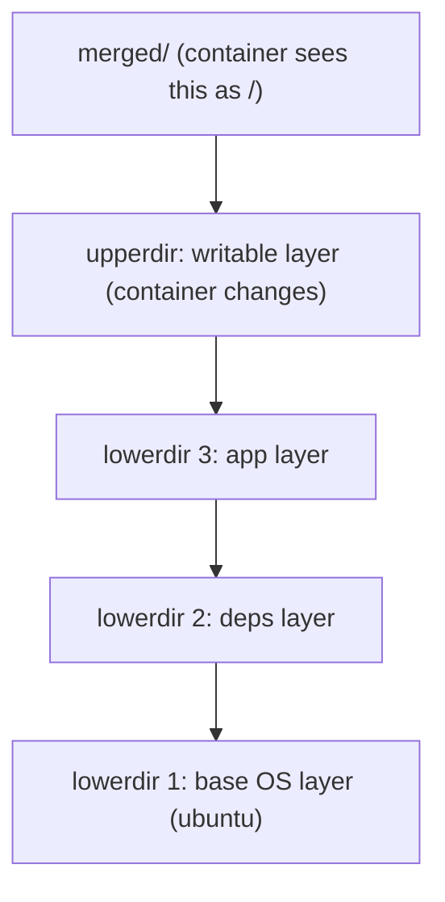

# 18 — Container Internals: Namespaces, cgroups, Union Filesystems

A container is **a normal Linux process** with:
1. **Namespaces** — what it can **see**.
2. **cgroups** — what it can **use**.
3. **Union filesystem** (overlayfs) — its root filesystem.
4. **Security** — capabilities, seccomp, SELinux/AppArmor.



## 1. Container Runtime Stack



## 2. Namespaces

| Namespace | Isolates | Flag |
|-----------|----------|------|
| pid | Process IDs (container sees itself as PID 1) | `CLONE_NEWPID` |
| net | Interfaces, IPs, routes, iptables, ports | `CLONE_NEWNET` |
| mnt | Mount points | `CLONE_NEWNS` |
| uts | Hostname | `CLONE_NEWUTS` |
| ipc | Shared memory, semaphores | `CLONE_NEWIPC` |
| user | UID/GID mapping (root inside, normal outside) | `CLONE_NEWUSER` |
| cgroup | cgroup tree view | `CLONE_NEWCGROUP` |
| time | Clocks (newer kernels) | `CLONE_NEWTIME` |

```bash
lsns                              # list namespaces
ls -l /proc/$$/ns                 # namespaces of your shell
sudo lsns -p $(pgrep -f nginx | head -1)

# Create namespaces by hand
sudo unshare --uts --pid --fork --mount-proc bash
hostname container1; ps aux      # only bash + ps visible

# Enter a container's namespaces
PID=$(docker inspect -f '{{.State.Pid}}' web)
sudo nsenter -t "$PID" -n ip addr      # network ns only
sudo nsenter -t "$PID" -a sh           # all namespaces
```

`nsenter -n` is very useful for debugging pod networking with host tools.

## 3. Network Namespaces



```bash
sudo ip netns add red
sudo ip netns add blue
sudo ip link add br0 type bridge && sudo ip link set br0 up
sudo ip link add veth-red type veth peer name veth-red-br
sudo ip link add veth-blue type veth peer name veth-blue-br
sudo ip link set veth-red netns red
sudo ip link set veth-blue netns blue
sudo ip link set veth-red-br master br0 up
sudo ip link set veth-blue-br master br0 up
sudo ip netns exec red ip addr add 10.0.0.1/24 dev veth-red
sudo ip netns exec blue ip addr add 10.0.0.2/24 dev veth-blue
sudo ip netns exec red ip link set veth-red up
sudo ip netns exec blue ip link set veth-blue up
sudo ip netns exec red ping -c2 10.0.0.2
```

This is how Docker bridge networking and many CNI plugins work.

## 4. cgroups v2

cgroups limit and account resources for groups of processes.

```bash
stat -fc %T /sys/fs/cgroup        # cgroup2fs = v2
cat /sys/fs/cgroup/cgroup.controllers
systemd-cgls                      # cgroup tree
systemd-cgtop                     # live usage per cgroup
cat /proc/self/cgroup
```



Key files:

| File | Meaning |
|------|---------|
| `cpu.max` | `quota period` — e.g. `50000 100000` = 0.5 CPU |
| `cpu.weight` | Relative share (1–10000, default 100) |
| `memory.max` | Hard limit → OOM kill above it |
| `memory.high` | Throttle point (soft) |
| `memory.current` | Usage now |
| `memory.events` | `oom`, `oom_kill` counters |
| `pids.max` | Max processes (fork bomb guard) |
| `io.max` | Disk bandwidth/IOPS limit |

### Manual cgroup

```bash
sudo mkdir /sys/fs/cgroup/demo
echo "+cpu +memory" | sudo tee /sys/fs/cgroup/cgroup.subtree_control
echo "50000 100000" | sudo tee /sys/fs/cgroup/demo/cpu.max
echo 200M | sudo tee /sys/fs/cgroup/demo/memory.max
echo $$ | sudo tee /sys/fs/cgroup/demo/cgroup.procs
```

### With systemd (preferred)

```bash
sudo systemd-run --scope -p MemoryMax=500M -p CPUQuota=50% ./batch.sh
sudo systemctl set-property nginx.service MemoryMax=1G CPUQuota=200%
```

### Kubernetes mapping

| Pod spec | cgroup |
|----------|--------|
| `resources.limits.cpu: 500m` | `cpu.max = 50000 100000` |
| `resources.requests.cpu: 250m` | `cpu.weight` (share) |
| `resources.limits.memory: 512Mi` | `memory.max` → OOMKilled at limit |
| QoS class | Parent slice: guaranteed / burstable / besteffort |

CPU limit hit → **throttling** (slow), not kill. Memory limit hit → **OOM kill**.

## 5. Union Filesystem (overlayfs)



- Image layers are read-only and shared between containers.
- Writes go to the upper layer (**copy-on-write**).
- Deleting the container removes the upper layer. Use volumes for data.

```bash
mkdir lower upper work merged
echo base > lower/a.txt
sudo mount -t overlay overlay -o lowerdir=lower,upperdir=upper,workdir=work merged
echo changed > merged/a.txt
cat lower/a.txt     # still "base"
cat upper/a.txt     # "changed"
docker inspect web -f '{{json .GraphDriver.Data}}'
```

## 6. Container Security Layers

| Layer | What it does | Check |
|-------|--------------|-------|
| Capabilities | Drop root powers | `docker run --cap-drop ALL --cap-add NET_BIND_SERVICE` |
| seccomp | Block syscalls | Default Docker profile blocks ~44 syscalls |
| User namespace | Root inside ≠ root outside | rootless podman/docker |
| SELinux/AppArmor | MAC labels per container | `ps -eZ \| grep container_t` |
| Read-only rootfs | No writes | `--read-only` |
| `no-new-privileges` | Block SUID escalation | `--security-opt no-new-privileges` |

`--privileged` disables most of these. Avoid it.

## 7. Build a Container by Hand (summary)

```bash
# 1. Get a root filesystem
mkdir rootfs && docker export $(docker create alpine) | tar -C rootfs -x
# 2. New namespaces + chroot into it
sudo unshare --pid --net --uts --ipc --mount --fork \
  chroot rootfs /bin/sh -c "mount -t proc proc /proc; hostname box; exec sh"
# 3. Limit it with a cgroup (add its PID to cgroup.procs)
```

## 8. Common Mistakes

| Mistake | Correct action |
|---------|----------------|
| Think containers are VMs | They share the host kernel |
| Store data in container layer | Use volumes/PVs |
| Set CPU limits too tight | Causes throttling; watch `cpu.stat` `nr_throttled` |
| App as PID 1 ignores signals | Use `tini` / `--init` / `exec` in entrypoint |
| `--privileged` for convenience | Add only needed capabilities |

## 9. Cheat Sheet

```bash
lsns; nsenter -t PID -n ip a; unshare --pid --fork --mount-proc bash
ip netns add x; ip netns exec x cmd
systemd-cgls; systemd-cgtop; cat /sys/fs/cgroup/<path>/memory.events
systemd-run --scope -p MemoryMax=500M cmd
mount -t overlay overlay -o lowerdir=,upperdir=,workdir= merged
```
