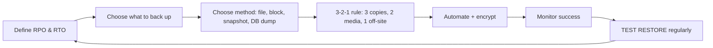
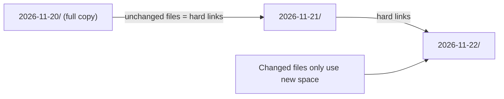

# 19 — Backup, Archiving, Compression

## 1. Backup Strategy First



- **RPO** (Recovery Point Objective): how much data loss is OK (e.g., 1 hour).
- **RTO** (Recovery Time Objective): how long restore may take.
- A backup you never restored is not a backup.

### What to back up on a Linux server

| Item | Path / method |
|------|---------------|
| Config | `/etc`, app configs |
| App data | `/var/lib/<app>`, `/srv`, `/home` |
| Databases | Use DB tools (`pg_dump`, `mysqldump`, xtrabackup), not raw files of a running DB |
| Package list | `rpm -qa` / `dpkg --get-selections` |
| Crontabs | `/var/spool/cron` |
| Infra as code | Git (Terraform, Ansible) — rebuild instead of restore |

## 2. Backup Types

| Type | Copies | Restore needs | Speed |
|------|--------|---------------|-------|
| Full | Everything | Last full | Slow backup, fast restore |
| Incremental | Changes since last backup | Full + all incrementals | Fast backup, slower restore |
| Differential | Changes since last full | Full + last differential | Middle |

## 3. tar

```bash
tar -cvf archive.tar dir/              # create
tar -czvf archive.tar.gz dir/          # + gzip
tar -cjvf archive.tar.bz2 dir/         # + bzip2
tar -cJvf archive.tar.xz dir/          # + xz
tar --zstd -cvf archive.tar.zst dir/   # + zstd (fast, good ratio)
tar -tvf archive.tar.gz                # list
tar -xzvf archive.tar.gz               # extract here
tar -xzvf archive.tar.gz -C /restore   # extract to dir
tar -xzvf archive.tar.gz etc/hosts     # extract one file
tar -czf etc-$(date +%F).tar.gz -C / etc   # relative paths
tar -czf - /data | ssh backup 'cat > /backups/data.tar.gz'   # stream over SSH
tar --exclude='*.log' --exclude='node_modules' -czf app.tgz app/
tar -cpzf ... --acls --xattrs --selinux    # keep perms, ACLs, labels
```

| Flag | Meaning |
|------|---------|
| c / x / t | Create / extract / list |
| v | Verbose |
| f | File name follows |
| z / j / J | gzip / bzip2 / xz |
| p | Keep permissions |
| C | Change dir |

## 4. Compression Tools

| Tool | Speed | Ratio | Ext |
|------|-------|-------|-----|
| gzip | Fast | Good | `.gz` |
| bzip2 | Slow | Better | `.bz2` |
| xz | Slowest | Best | `.xz` |
| zstd | Very fast | Very good | `.zst` |
| zip | Fast | Good | `.zip` (Windows-friendly) |

```bash
gzip file; gunzip file.gz; zcat file.gz; zgrep error file.gz
xz -T0 file          # all cores
zstd -19 file; unzstd file.zst
pigz                 # parallel gzip
zip -r a.zip dir; unzip a.zip
```

## 5. rsync

```bash
rsync -aHAXv --delete /data/ /mnt/backup/data/
rsync -avz --progress /data/ backup:/srv/backup/data/
rsync -avn --delete src/ dst/              # dry run first!
rsync -a --link-dest=/backup/2026-11-20 /data/ /backup/2026-11-21/   # space-saving snapshots
```

| Flag | Meaning |
|------|---------|
| -a | Archive (recursive, perms, times, links, owner) |
| -H -A -X | Hard links, ACLs, xattrs |
| -z | Compress in transit |
| --delete | Remove files in dst not in src (mirror) |
| -n | Dry run |
| --bwlimit=10M | Limit bandwidth |

### --link-dest snapshots



Each dir looks like a full backup but only changed files use space.

## 6. dd — Block-Level Copy

```bash
sudo dd if=/dev/sdb of=/backup/sdb.img bs=4M status=progress conv=fsync
sudo dd if=/backup/sdb.img of=/dev/sdc bs=4M status=progress
sudo dd if=/dev/zero of=/dev/sdX bs=1M count=10    # wipe start of disk
```

**Danger:** `dd` to the wrong `of=` destroys data with no warning. Check `lsblk` first.

## 7. Snapshots

| Layer | Tool |
|-------|------|
| LVM | `lvcreate -s` (module 09) |
| btrfs | `btrfs subvolume snapshot` |
| ZFS | `zfs snapshot` |
| Cloud | EBS snapshots, AWS Backup, DLM |
| VM | Hypervisor snapshots |

A snapshot on the same disk is not a backup. Copy it elsewhere.

Consistent snapshot of a running app: freeze writes first.

```bash
sudo fsfreeze -f /data
# take snapshot
sudo fsfreeze -u /data
```

## 8. Modern Backup Tools

| Tool | Features |
|------|----------|
| restic | Encrypted, deduplicated, S3/B2/SFTP backends |
| borg | Dedup, compression, encryption |
| Bacula / Bareos | Enterprise, client-server |
| AWS Backup | Managed EBS/RDS/EFS backups |
| Velero | Kubernetes resources + PV backups |

```bash
restic -r s3:s3.amazonaws.com/my-bucket init
restic -r s3:... backup /etc /var/lib/app
restic -r s3:... snapshots
restic -r s3:... restore latest --target /restore
restic -r s3:... forget --keep-daily 7 --keep-weekly 4 --prune
```

## 9. Database Backups

```bash
pg_dump -Fc mydb > mydb-$(date +%F).dump
pg_restore -d mydb_restore mydb-2026-11-21.dump
mysqldump --single-transaction --routines mydb | gzip > mydb.sql.gz
```

## 10. Common Mistakes

| Mistake | Correct action |
|---------|----------------|
| Never test restore | Schedule restore drills |
| Backups on same disk/host | Off-site / other account / other region |
| Copy raw DB files while running | Use dump tools or consistent snapshots |
| `rsync --delete` with wrong path | Dry run with `-n` |
| Absolute paths in tar | Use `-C /` and relative paths |
| Unencrypted backups off-site | Encrypt (restic/borg/gpg) |

## 11. Cheat Sheet

```bash
tar -czpf a.tgz -C / etc; tar -tzf a.tgz; tar -xzf a.tgz -C /restore
rsync -aHAXn --delete src/ dst/
dd if= of= bs=4M status=progress
restic backup; restic restore latest --target /r
fsfreeze -f /m; fsfreeze -u /m
```
