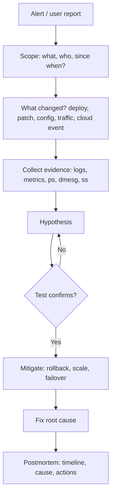
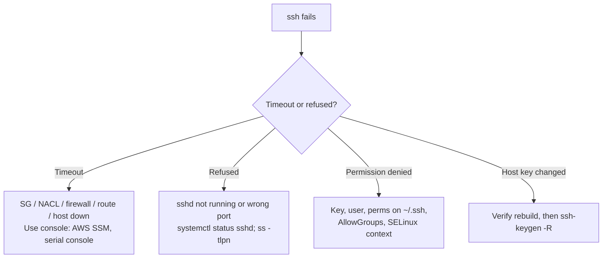
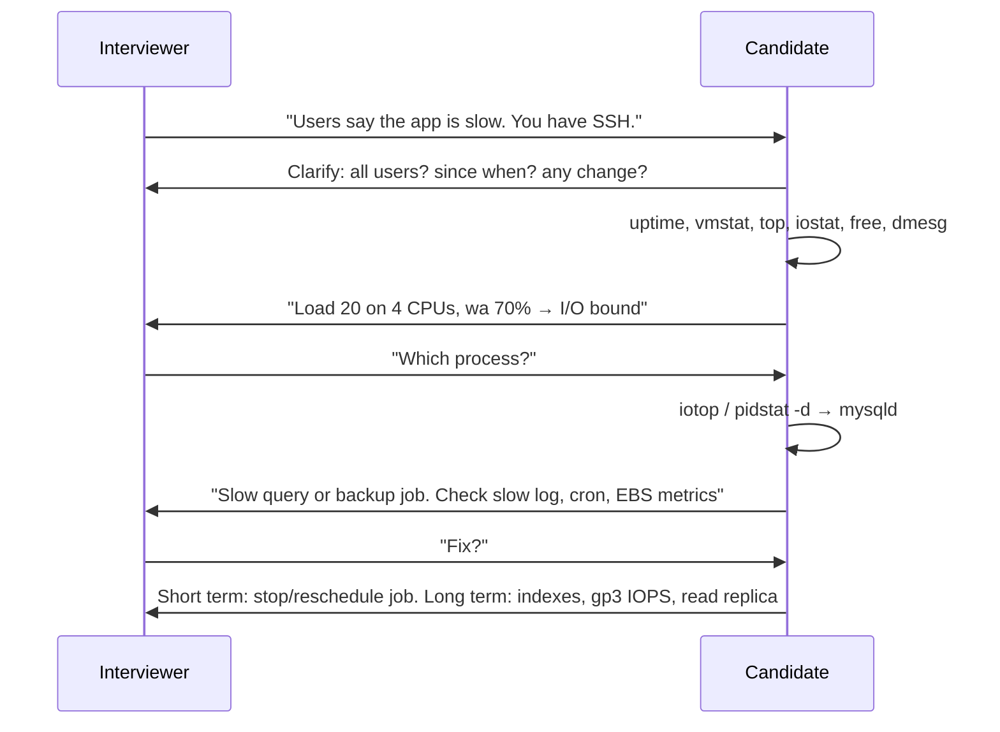

# 20 — Capstone: Real-World Scenarios and Interview Drills

This module joins all earlier modules. Use it for interview prep and on-call practice.

## 1. Universal Incident Flow



## 2. Scenario Playbooks

### S1 — "Server is slow"

```bash
uptime; nproc
vmstat 1 5
top -o %CPU; ps aux --sort=-rss | head
iostat -xz 1 3
free -h; dmesg -T | tail -30
df -h; df -i
ss -s
```

Map the result with the module 16 decision tree.

### S2 — "Disk full"

```bash
df -h; df -i
sudo du -xh / --max-depth=2 2>/dev/null | sort -h | tail -20
sudo lsof +L1                      # deleted but open
sudo journalctl --vacuum-size=500M
sudo find /var/log -name "*.gz" -mtime +14 -delete
docker system df; docker system prune     # container hosts
```

Then: logrotate rules, alerts at 80%, grow the volume (LVM/EBS).

### S3 — "Cannot SSH"



### S4 — "Service won't start"

```bash
systemctl status app -l --no-pager
journalctl -u app -b --no-pager | tail -50
systemctl cat app
sudo -u appuser /opt/app/bin/start      # run as the service user
ss -tlpn | grep :8080                   # port already in use?
ls -lZ /opt/app /etc/app                # perms + SELinux
sudo ausearch -m AVC -ts recent
```

### S5 — "Website returns 502"

1. Is the backend running? `systemctl status app`, `ss -tlpn`.
2. Can the proxy reach it? `curl -v http://127.0.0.1:3000` from the proxy host.
3. SELinux? `setsebool -P httpd_can_network_connect on`.
4. Proxy logs: `/var/log/nginx/error.log`.
5. Timeouts vs refused vs reset tell different stories.

### S6 — "Boot fails"

1. Console access (cloud serial console / VM console).
2. Emergency mode → check `/etc/fstab`, `journalctl -xb`.
3. Kernel panic → boot older kernel from GRUB.
4. Root password lost → `rd.break` (module 08).
5. Cloud: detach root volume, attach to a rescue instance, fix files, reattach.

### S7 — "High memory, OOM kills"

```bash
dmesg -T | grep -i -A5 "out of memory"
ps aux --sort=-rss | head
cat /sys/fs/cgroup/system.slice/app.service/memory.events
smem -rk | head
```

Fix: memory limits, fix leaks, add swap as a buffer, right-size the instance.

### S8 — "DNS is broken"

```bash
cat /etc/resolv.conf; resolvectl status
dig example.com; dig @1.1.1.1 example.com
getent hosts example.com
grep hosts /etc/nsswitch.conf
```

### S9 — "Clock is wrong" (TLS errors, token failures)

```bash
timedatectl
chronyc sources -v; chronyc tracking
sudo chronyc makestep
```

### S10 — "Too many open files"

```bash
cat /proc/$(pidof app)/limits | grep "open files"
ls /proc/$(pidof app)/fd | wc -l
sysctl fs.file-nr
```

Fix: `LimitNOFILE=` in unit, check fd leaks.

## 3. Interview Question Bank (Rapid Fire)

| # | Question | Short answer |
|---|----------|-------------|
| 1 | What happens when you type `ls -l` and press Enter? | Shell parses, expands, finds binary in PATH, fork+exec, ls makes syscalls (getdents, stat), output to stdout, shell waits |
| 2 | Hard vs soft link? | Same inode vs path pointer (module 02) |
| 3 | Find files > 1 GB? | `find / -xdev -type f -size +1G` |
| 4 | What is load average? | Avg tasks in R + D state over 1/5/15 min |
| 5 | Zombie process? | Exited, parent not reaped. Fix parent |
| 6 | SIGTERM vs SIGKILL? | Graceful vs forced, uncatchable |
| 7 | What is an inode? | Metadata record, no name |
| 8 | `df` and `du` disagree? | Deleted open files, hidden under mounts |
| 9 | Explain the boot process | Firmware → GRUB → kernel+initramfs → systemd → targets |
| 10 | Check open ports? | `ss -tulpn` |
| 11 | What is umask 022? | New files 644, dirs 755 |
| 12 | SUID example? | `/usr/bin/passwd` |
| 13 | Extend a filesystem online? | `lvextend -r` or `growpart` + `xfs_growfs` |
| 14 | `/etc/passwd` vs `/etc/shadow`? | Info vs hashes |
| 15 | How does DNS resolution work on Linux? | nsswitch → /etc/hosts → resolv.conf |
| 16 | What is swap? When bad? | Disk-backed memory; heavy si/so = thrash |
| 17 | Container vs VM? | Shared kernel + namespaces/cgroups vs own kernel |
| 18 | What is a cgroup? | Resource limit/accounting for process groups |
| 19 | Process using a port? | `ss -tlpn 'sport = :80'`, `lsof -i :80` |
| 20 | Why is `kill -9` bad as default? | No cleanup, data loss, stale locks |
| 21 | What is `/proc`? | Virtual FS with kernel/process data |
| 22 | Explain `2>&1` | Redirect stderr to where stdout points |
| 23 | Make a change survive reboot (sysctl, route, mount, module) | sysctl.d, nmcli/netplan, fstab, modules-load.d |
| 24 | What does `nohup` do? | Ignore SIGHUP so process survives logout |
| 25 | What is SELinux and how to fix a denial? | MAC; restorecon / semanage / setsebool |
| 26 | Difference between `apt update` and `apt upgrade`? | Refresh metadata vs install new versions |
| 27 | What is `/etc/fstab` `nofail`? | Boot continues if device missing |
| 28 | How do you see the last reboot? | `last reboot`, `who -b`, `uptime -s` |
| 29 | What is TIME_WAIT? | Post-close state on active closer, 2×MSL |
| 30 | How would you secure a new server? | Module 15 checklist |

## 4. Mock Interview Flow



Speak your reasoning aloud. Interviewers grade the **method** more than the final answer.
